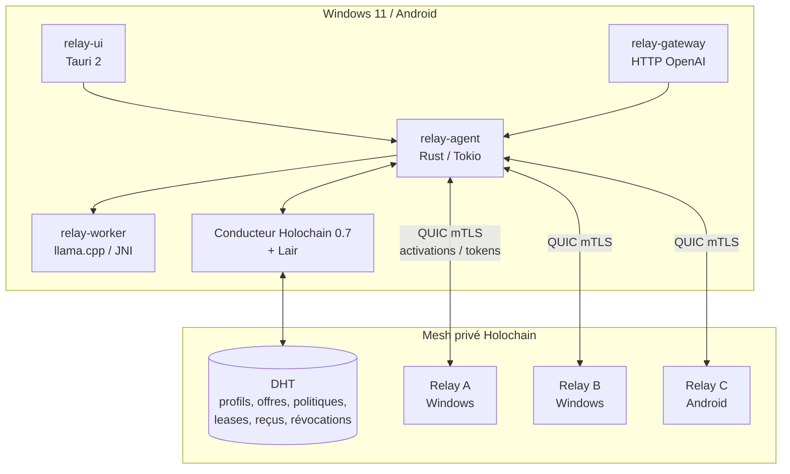
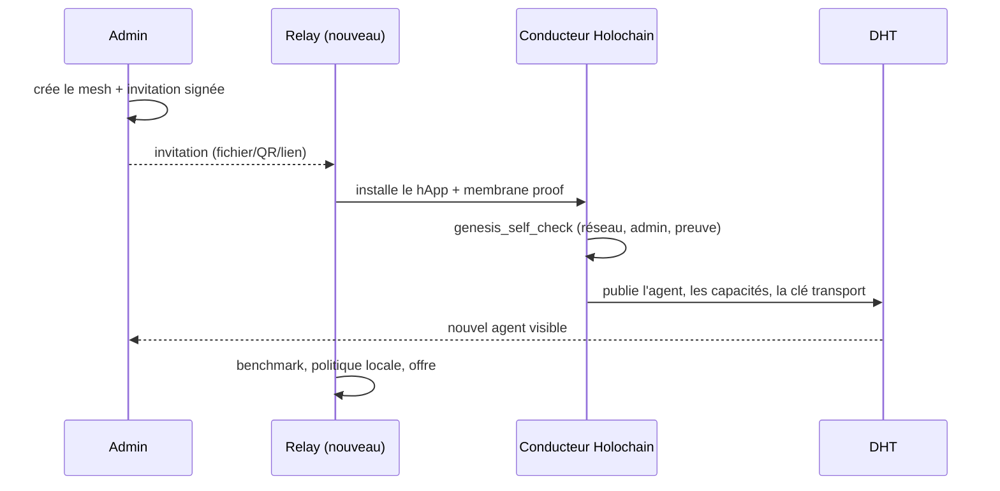
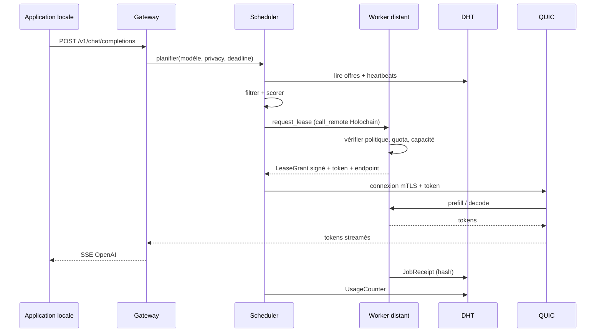
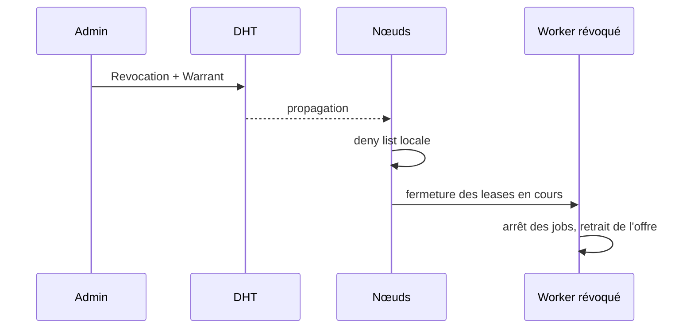

# Cahier des charges — AInonymous Relay

## Module de relais de calcul GPU pour LLM locaux, orchestré en mesh Holochain (Windows / Android)

| Élément | Valeur |
|---|---|
| Version du document | 0.2 — décisions structurantes verrouillées |
| Date | 21 octobre 2026 |
| Dépôt analysé | [`Geoking2104/AInonymous`](https://github.com/Geoking2104/AInonymous) |
| Commit de référence | `1824be9fcc331a8205c5a9e785390d33b79b62e5` (24 août 2026) |
| Périmètre cible | Windows 11 x64 (Windows 10 22H2 en best-effort), Android 10+ arm64 |
| Statut du dépôt | Alpha de recherche, non audité, adapté aux pilotes privés contrôlés |
| Décisions actées | Mesh privé ; Android agent complet via Tauri ; distribution directe signée |
| Objet | Spécifier la fonctionnalité de téléchargement, d'installation et d'exploitation d'un relais de calcul GPU, ainsi que son intégration au mesh Holochain |

---

**Sommaire**

0. Résumé exécutif
1. Contexte, objectifs et périmètre
2. Audit du dépôt et blocs réutilisables
3. Utilisateurs, parcours et cas d'usage
4. Exigences fonctionnelles
5. Exigences non fonctionnelles et techniques
6. Architecture cible
7. Conception technique détaillée
8. Plan de réutilisation et de refactorisation
9. Plan de réalisation
10. Stratégie de test et critères d'acceptation
11. Risques et mitigations
12. Décisions actées et questions ouvertes
13. Annexes

---

## 0. Résumé exécutif

### 0.1 La demande

Permettre à un utilisateur de **télécharger un module sur Windows et Android**, de l'installer, puis de :

1. **utiliser des modèles LLM en local** derrière une API compatible OpenAI ;
2. **partager volontairement la puissance GPU** de sa machine avec des pairs **autorisés** ;
3. **paralléliser** le calcul sur plusieurs machines d'un **mesh coordonné par Holochain** ;
4. garder le **contrôle** : qui peut consommer, quand, combien, pour quels modèles, avec quel plafond de VRAM, de température, de batterie et de réseau.

### 0.2 Le constat principal

Le dépôt AInonymous fournit des **fondations solides et déjà écrites** pour le plan de contrôle Holochain et le plan de données QUIC/mTLS. En revanche, **il ne contient aujourd'hui aucun produit Windows ou Android téléchargeable, aucun mécanisme de partage GPU avec autorisation, aucun protocole de lease, aucune comptabilité d'usage et aucun relais réseau pour les réseaux mobiles**.

Autrement dit : la fonctionnalité demandée n'est pas une case à cocher dans le dépôt existant ; c'est un **produit à construire autour d'un noyau réutilisable**. Le présent document distingue systématiquement :

- ce qui **existe et est réutilisable** (avec le chemin et la ligne dans le dépôt) ;
- ce qui **existe mais est un prototype** (à durcir, pas à présenter comme acquis) ;
- ce qui **n'existe pas** et doit être conçu et développé.

### 0.3 Les cinq décisions structurantes recommandées

| # | Décision | Justification synthétique |
|---|---|---|
| D1 | **Holochain coordonne, QUIC transporte** | Holochain n'est pas un moteur de calcul distribué ; il authentifie, découvre, autorise et audite. Les tenseurs, prompts et tokens ne doivent jamais passer par la DHT. C'est déjà l'invariant du dépôt. |
| D2 | **Le mode par défaut est la réplication de modèle, pas le pipeline** | Le pipeline parallèle ajoute un aller-retour réseau **par token** ; il n'est viable qu'en LAN rapide ou pour un modèle qui ne tient pas sur une machine. Le mode « réplique » (modèle entier sur un pair) est robuste, compatible WAN, et délivre la montée en charge. |
| D3 | **Un lease signé, court et révocable, autorise chaque job** | Le contrôle d'accès ne peut pas reposer sur la seule membrane Holochain : il faut une autorisation par paire, par modèle, par plage horaire et par quota, vérifiée localement par le worker. |
| D4 | **Windows d'abord, Android ensuite, avec un noyau Rust commun** | Windows est le gisement GPU et le chemin critique de valeur. Android est un nœud de capacité complémentaire, très contraint (thermique, batterie, arrière-plan, NAT). Un socle Rust partagé évite deux implémentations. |
| D5 | **Pas de token crypto ni de marché public en v1** | Le besoin est un partage autorisé entre pairs, pas une place de marché financiarisée. La réciprocité (minutes données / minutes consommées) suffit et évite les risques réglementaires, spéculatifs et de sécurité. |

### 0.4 Ce que le dépôt ne fait pas aujourd'hui

| Absence | Preuve dans le dépôt | Impact |
|---|---|---|
| Application Windows installable | Aucun `tauri.conf.json`, MSI, service Windows, tray, installeur ; la CI ne construit que sous Ubuntu | Bloquant pour la demande |
| Application Android | Aucune cible Android, aucun JNI/UniFFI, aucun `AndroidManifest.xml` | Bloquant pour la demande |
| Partage GPU avec consentement | Aucune entrée `ResourceOffer`, `AccessPolicy`, `Lease`, `Quota`, `Receipt` | Bloquant pour la demande |
| Relais réseau / NAT traversal | `quic_relay_fallback` existe en configuration mais aucun code de relais applicatif pour le data plane ; le relais Iroh de Holochain ne couvre pas les activations | Bloquant pour l'usage mobile hors LAN/VPN |
| Pipeline natif llama.cpp | Patch expérimental, non upstreamé, non rebasé, non testé Windows/Android | Risque majeur pour le mode pipeline |
| Télémétrie multiplateforme | `heartbeat.rs` lit `/proc/loadavg`, `/sys/class/hwmon`, `/proc/meminfo` ; la détection GPU appelle `nvidia-smi`/`rocm-smi` | Aveugle sur Android, partiel sur Windows |
| Streaming mesh réel | Le proxy découpe la réponse finale en mots pour simuler le SSE | Mauvaise UX, latence perçue |

### 0.5 Ordre de grandeur

| Lot | Durée | Résultat |
|---|---|---|
| Phase 0 — préparation + spikes | 5 semaines (1 + 4) | Go/no-go Android Tauri + agent Holochain complet, Vulkan mobile, pipeline natif, NAT |
| Phase 1 — Windows MVP | 10 semaines | Nœud Windows installable, partage autorisé, gateway OpenAI, audit |
| Phase 2 — Android | 10 semaines | Application Android, service de premier plan, worker Vulkan/CPU |
| Phase 3 — pipeline distribué | 8 semaines | Pipeline 2–4 nœuds en LAN, scheduler, reçus |
| Phase 4 — durcissement | 6 semaines | Audit, fuzzing, pilote, documentation |
| **Total** | **~36–40 semaines** | **4–5 ETP en moyenne, 6–7 au pic** |

Le MVP Windows est atteignable en **15 semaines** environ. Un pilote Windows + Android est atteignable en **25 à 27 semaines**.

### 0.6 Décisions actées le 21 octobre 2026

| # | Décision | Conséquence directe |
|---|---|---|
| **D6** | **Mesh privé en v1** | Admission par invitation + membrane proof ; pas de mode public, pas de résistance Sybil à démontrer ; la révocation et l'UX d'invitation deviennent critiques. |
| **D7** | **Android = agent Holochain complet via Tauri** | Tauri 2 et p2p Shipyard passent sur le chemin critique ; le worker appairé n'est plus le repli par défaut ; la Phase 0 doit prouver le fonctionnement avant tout engagement de Phase 1. |
| **D8** | **Distribution directe signée** | Pas de dépendance aux stores ; l'équipe porte la signature, le CDN de mise à jour, la réputation SmartScreen, la procédure de sideload Android et le support. |

Ces trois décisions remplacent les questions Q1, Q2 et Q4 de la version 0.1. Elles sont intégrées dans l'architecture (section 6), le runtime Android (section 7.2), la distribution (section 7.16), le plan (section 9) et les risques (section 11).

---

## 1. Contexte, objectifs et périmètre

### 1.1 Contexte produit

AInonymous se présente comme un **plan de contrôle agent-centrique pour l'inférence LLM distribuée** combinant :

- **Holochain 0.7** pour l'identité, les capacités, la coordination, les plans et l'audit ;
- **QUIC + TLS 1.3/mTLS** pour le trafic d'inférence et les activations ;
- un adaptateur **SD-WAN** optionnel pour la topologie et les SLA ;
- des **daemons Rust** et des adaptateurs **llama.cpp / PyTorch** pour l'exécution.

Le dépôt est explicitement en **alpha de recherche**, sans audit indépendant, sans anonymat réseau, sans résistance Sybil publique complète, et sans exécution multi-nœuds native aboutie. Toute spécification doit partir de cette réalité, pas du discours marketing du site.

### 1.2 Problème à résoudre

Un utilisateur possède un PC Windows avec un GPU de 8 à 24 Go de VRAM, ou un smartphone Android récent. Il veut :

- faire tourner un LLM **chez lui**, sans envoyer ses prompts à un cloud ;
- utiliser un modèle **plus gros que sa VRAM** ou **plus rapidement** que ce que sa machine permet seule ;
- **prêter** sa puissance inutilisée à un groupe de confiance (famille, équipe, association, PME) ;
- **emprunter** la puissance des autres membres quand il en a besoin ;
- ne jamais devenir une ressource exploitable par un inconnu, un botnet ou un mineur de crypto.

### 1.3 Objectifs mesurables

| Objectif | Indicateur | Cible v1 |
|---|---|---|
| O1 — Installation simple | Temps d'installation et de première inférence | < 5 minutes, sans admin sur Windows, sans ADB sur Android |
| O2 — Usage local | Débit de la gateway locale vs llama.cpp direct | ≥ 95 % du débit natif, surcoût TTFT < 50 ms |
| O3 — Partage autorisé | Taux de refus des pairs non autorisés | 100 % sur la matrice de tests |
| O4 — Capacité distribuée | Jobs simultanés sur 5 nœuds | ≥ 4× le débit d'un nœud seul en mode réplique |
| O5 — Modèle trop gros | Pipeline 2–3 nœuds en LAN 2,5 GbE | Modèle 30B Q4 exécutable, ≥ 15 tok/s en décodage |
| O6 — Contrôle propriétaire | Application d'un quota et d'une fenêtre horaire | Refus immédiat, journalisé, sans intervention manuelle |
| O7 — Fiabilité | Soak test 7 jours | Aucune fuite mémoire, reprise après crash, 0 job bloqué |
| O8 — Sécurité | Findings critiques/hauts avant pilote | 0 critique, 0 haut non mitigé |

### 1.4 Périmètre

#### Inclus

- Application **Windows 11 x64** (prioritaire), Windows 10 22H2 en best-effort.
- Application **Android 10+ arm64** (téléphone/tablette), avec service de premier plan.
- Rôles **consommateur**, **contributeur**, **les deux**.
- Gateway locale **OpenAI-compatible** (`/v1/models`, `/v1/chat/completions`, streaming).
- Partage GPU **opt-in**, avec allowlist, leases, quotas, fenêtres horaires, garde-fous thermiques/batterie/réseau.
- Modes **local**, **réplique**, **pipeline**, **spéculatif**.
- Mesh **privé Holochain** (membrane proof), discovery, offres, leases, reçus, révocation.
- Packaging, signature, mise à jour, désinstallation.
- Observabilité locale, audit, export de diagnostic.

#### Exclu de la v1

- Marché public ouvert, anonymat réseau, résistance Sybil publique.
- Token crypto, paiement, facturation, conversion en monnaie.
- Tensor parallelism, expert parallelism (MoE) en production.
- Inférence confidentielle (TEE/HE), chiffrement de bout en bout des activations vis-à-vis du worker.
- macOS et Linux comme cibles produit (le dépôt les supporte partiellement, mais ce n'est pas la demande).
- Modèles multimodaux, embeddings, RAG intégré.
- Entraînement ou fine-tuning distribué.
- Stockage des poids sur la DHT.

#### Décisions de périmètre (verrouillées)

- **Mesh strictement privé** : aucune exposition publique, aucune promesse d'anonymat ou de Sybil-résistance.
- **Android agent complet** : le téléphone exécute son propre agent Holochain et son conductor via Tauri ; le mode « worker appairé » est hors périmètre, sauf réouverture explicite de la décision après échec du spike.
- **Distribution directe** : installeur Windows et APK signés depuis une page officielle ; les stores ne sont pas un canal requis (un canal interne optionnel reste possible).
- **Windows 11 prioritaire** ; Windows 10 22H2 best-effort.

### 1.5 Vocabulaire

| Terme | Définition dans ce document |
|---|---|
| **Relais de calcul** | Nœud qui met à disposition son GPU/CPU pour exécuter tout ou partie d'un modèle. |
| **Relais réseau** | Nœud qui relaie le trafic QUIC pour franchir un NAT (à ne pas confondre avec le relais de calcul). |
| **Worker** | Processus isolé qui exécute effectivement les couches ou le modèle. |
| **Gateway** | Point d'entrée local OpenAI-compatible pour les applications de l'utilisateur. |
| **Offre (`ResourceOffer`)** | Déclaration signée des ressources, modèles, limites et disponibilités d'un nœud. |
| **Politique (`AccessPolicy`)** | Règles du propriétaire : qui, quoi, quand, combien. |
| **Lease** | Autorisation signée, limitée dans le temps et dans son objet, d'exécuter un job précis. |
| **Reçu (`JobReceipt`)** | Preuve signée d'exécution et de consommation, utilisée pour les quotas et l'audit. |
| **Mesh** | Ensemble des agents Holochain partageant la même DNA privée. |
| **Pipeline** | Découpage d'un modèle en plages de couches exécutées par des nœuds successifs. |
| **Réplique** | Modèle entier présent sur plusieurs nœuds ; les requêtes sont réparties. |
| **Spéculatif** | Un petit modèle « brouillon » propose K tokens, un gros modèle « vérificateur » les valide en une passe. |
| **C0 / C1 / C2** | Classes de confidentialité : local seul / mesh de confiance / mesh public (hors v1). |
| **DHT** | Table de hachage distribuée Holochain : registre validé et répliqué, sans base centrale. |
| **mTLS** | TLS mutuel : le client et le serveur présentent chacun un certificat. |
| **NAT** | Traduction d'adresses réseau ; empêche souvent une connexion directe entre deux machines. |
| **TTL** | Durée de validité applicative d'une offre, d'un lease ou d'un profil. |
| **SSE** | Server-Sent Events : flux HTTP unidirectionnel utilisé pour le streaming de tokens. |
| **GGUF** | Format de fichier de modèle de llama.cpp, souvent quantifié (Q4_K_M, Q8_0…). |
| **KV-cache** | Cache des clés/valeurs d'attention, qui évite de recalculer le contexte à chaque token. |
| **VRAM** | Mémoire dédiée du GPU. |
| **Warrant** | Sanction signée contre un agent (mauvais hash, fausse attestation, timeout répété). |

### 1.6 Définition du « module » téléchargeable

Le mot « module » peut désigner plusieurs artefacts. La spec en distingue quatre, pour éviter les ambiguïtés de packaging et de mise à jour :

| Artefact | Contenu | Téléchargement | Rôle |
|---|---|---|---|
| **AInonymous Relay (application)** | UI Tauri, agent, gateway, client Holochain, worker de base | Installeur Windows / APK Android | Produit complet pour l'utilisateur final |
| **Backend Pack** | Bibliothèques llama.cpp compilées pour CUDA, Vulkan ou CPU, avec manifeste et hash | À la demande, après détection GPU | Réduit la taille de l'installeur et permet de supporter plusieurs GPU |
| **Model Pack** | Fichier GGUF + `ModelManifest` (SHA-256, licence, taille, couches, contexte) | À la demande, depuis une source officielle ou un miroir autorisé | Les poids ne sont jamais dans l'application ni dans la DHT |
| **Relay SDK** (option) | DLL Windows / AAR Android exposant l'API locale et le cycle de vie du nœud | Canal développeur | Intégration dans une application LLM existante |

**Règle de distribution** : l'application et les backend packs sont **signés** ; les model packs sont **hashés** et leur licence est acceptée explicitement. Un backend pack non signé ou un modèle dont le hash ne correspond pas est refusé.

---

## 2. Audit du dépôt et blocs réutilisables

### 2.1 Méthode

Audit **statique** du commit `1824be9`, sans exécution de build ni de test :

- lecture des documents d'architecture, sécurité, réseau, API et intégration ;
- lecture des 61 fichiers Rust (~9 900 lignes) et des 16 fichiers Python (~2 200 lignes) ;
- lecture des zomes et des manifestes hApp ;
- vérification des workflows CI, des scripts de testnet et des configurations ;
- recherche des marqueurs `TODO`/`FIXME`, des cibles `cfg(target_os)` et des fonctionnalités annoncées mais absentes.

**Limite** : cet audit ne remplace pas une revue de code exhaustive ni un test d'intégration. Les conclusions de maturité sont des jugements d'ingénierie, pas des certificats.

### 2.2 Architecture réellement présente

| Plan | Implémentation | Maturité |
|---|---|---|
| Contrôle | Holochain 0.7, trois rôles `agent-registry`, `inference-mesh`, `blackboard`, plus le hApp `hybridnode` | Prototype avancé, testé en CI WASM, mais planification naïve |
| Données | QUIC/TLS 1.3, mTLS Ed25519, sessions à token, transfert d'activations, stream de tokens | Prototype avancé, LAN, sans relais NAT |
| Identité | Agent Holochain dans Lair + clé transport Ed25519 séparée, liée par provenance | Bonne conception, implémentée |
| Admission | DNA privée + `PrivateNetworkProof` au genesis | Implémentée, sans révocation temps réel |
| Exécution | `llama-server` local (solo), `pipeline_server.py` (plages de couches), patch llama.cpp expérimental | Prototype, Linux-centré, non mobile |
| Packaging | Docker Compose Linux, scripts WSL, aucun installeur | Absent pour Windows/Android |
| Sécurité | Invariants validés par configuration, QUIC strict, admin loopback | Correcte pour un pilote, non auditée |

### 2.3 Blocs réutilisables

Le tableau ci-dessous est la réponse directe à la demande « vérifie sur le dépôt les blocs réutilisables ». Les niveaux sont : **R** = réutilisable tel quel, **A** = réutilisable avec adaptation, **P** = prototype à durcir, **N** = à créer.

| # | Bloc | Emplacement / preuve | Usage dans Relay | Niveau |
|---|---|---|---|---|
| R1 | **Types de plans et d'activations** | [`ainonymous-types/inference.rs`](../crates/ainonymous-types/src/inference.rs#L125-L214) : `ExecutionPlan`, `ActivationHeader` 64 octets, `DType` ; [`node.rs`](../crates/ainonymous-types/src/node.rs#L138-L182) : `Solo`, `PipelineSplit`, `ExpertShard`, `Speculative` | Schéma commun entre gateway, scheduler et worker ; en-tête binaire stable pour les transferts | **R** |
| R2 | **Identité de transport et mTLS** | [`ainonymous-quic/mtls.rs`](../crates/ainonymous-quic/src/mtls.rs) : certificat Ed25519 auto-signé, `PeerKeyVerifier`, `Ed25519ClientVerifier` ; [`lib.rs`](../crates/ainonymous-quic/src/lib.rs#L30-L61) : endpoint serveur strict | Authentification mutuelle des nœuds, pinning de clé, séparation des clés Holochain/QUIC | **R** |
| R3 | **Session et token éphémère** | [`session.rs`](../crates/ainonymous-quic/src/session.rs#L10-L165) : `SessionOffer`, token 32 octets, TTL 30 s, `connect` avec pinning ; [`listener.rs`](../crates/ainonymous-quic/src/listener.rs#L95-L172) : vérification token + clé client | Poignée de main d'un job, à étendre avec `lease_id` et portée | **A** |
| R4 | **Transfert d'activations** | [`transfer.rs`](../crates/ainonymous-quic/src/transfer.rs#L14-L131) : envoi/réception, taille bornée 512 Mo, zstd ; [`codec.rs`](../crates/ainonymous-quic/src/codec.rs) : frames typées | Transport des hidden states et des tokens entre étages | **A** |
| R5 | **Registre d'agents** | [`agent-registry/coordinator`](../dnas/ainonymous-core/dnas/agent-registry/zomes/coordinator/src/lib.rs#L6-L136) : `announce_capabilities`, `heartbeat`, `get_available_nodes` ; [`integrity`](../dnas/ainonymous-core/dnas/agent-registry/zomes/integrity/src/lib.rs#L5-L146) : validation auteur, liens, clé transport | Découverte des nœuds, capacités, modèles, endpoints, heartbeat | **A** |
| R6 | **Négociation de session via Holochain** | [`inference-mesh/coordinator`](../dnas/ainonymous-core/dnas/inference-mesh/zomes/coordinator/src/lib.rs#L57-L194) : `negotiate_quic_session`, `request_remote_session`, vérification de la clé annoncée par la provenance ; plan [`compute_execution_plan`](../dnas/ainonymous-core/dnas/inference-mesh/zomes/coordinator/src/lib.rs#L226-L327) | Liaison identité Holochain ↔ session QUIC, négociation distante | **P** pour le plan, **R** pour la négociation |
| R7 | **Blackboard** | [`blackboard`](../dnas/ainonymous-core/dnas/blackboard) : posts typés, TTL, tags, filtrage PII | Coordination légère, annonces, journal de bord ; **pas** pour les prompts ni les heartbeats haute fréquence | **A** |
| R8 | **Admission privée, attestations, warrants** | [`hybridnode/integrity`](../dnas/hybridnode/dnas/hybridnode-core/zomes/integrity/src/lib.rs#L6-L99) : `NodeAttestation`, `ModelManifest`, `ModelClaim`, `Warrant`, `WarrantRefutation` ; [`coordinator`](../dnas/hybridnode/dnas/hybridnode-core/zomes/coordinator/src/lib.rs#L10-L163) : publication, claim, warrants, statut | Confiance, réputation, sanctions, preuve de modèle | **A** |
| R9 | **Membrane proof** | [`hybridnode/integrity`](../dnas/hybridnode/dnas/hybridnode-core/zomes/integrity/src/lib.rs#L296-L431) : `HybridNodeDnaProperties`, `PrivateNetworkProof`, `genesis_self_check` | Admission d'un appareil dans un mesh privé | **A** (expiration à concevoir) |
| R10 | **Scheduler et topologie** | [`hybridnode-core/scheduler.rs`](../crates/hybridnode-core/src/scheduler.rs#L50-L185) : `LocalFirst`, `LowestLatency`, `HighestBandwidth`, `RoundRobin` ; [`topology.rs`](../crates/hybridnode-core/src/topology.rs#L17-L96) : SLA, liens, pairs ; [`model.rs`](../crates/hybridnode-core/src/model.rs#L29-L75) : SHA-256, transfert | Base du futur scheduler, à brancher sur les offres et leases | **A** |
| R11 | **Orchestration pipeline et spéculatif** | [`conductor.rs`](../crates/ainonymous-daemon/src/conductor.rs#L58-L418) : chaîne de nœuds, KV-cache, passes prefill/decode, décodage spéculatif | Cœur du mode pipeline et du mode spéculatif | **P** |
| R12 | **Gestion llama.cpp et VRAM** | [`llama.rs`](../crates/ainonymous-daemon/src/llama.rs#L140-L386) : détection GPU, `n_gpu_layers`, estimation VRAM, lancement `llama-server` | Backend principal Windows ; à porter sur Android via JNI | **A** |
| R13 | **Gateway OpenAI** | [`ainonymous-proxy`](../crates/ainonymous-proxy/src/handlers/chat.rs) : `/v1/chat/completions`, SSE, routage mesh ; [`api.rs`](../crates/ainonymous-types/src/api.rs) : DTO | Point d'entrée local pour les applications utilisateur | **A** |
| R14 | **Pipeline Python / PyTorch** | [`scripts/pipeline_server.py`](../scripts/pipeline_server.py) ; [`examples/pytorch`](../examples/pytorch) : `PipelineSplit`, `pack_activation`, format binaire sans pickle | Prototype de référence pour le pipeline, utile en Phase 0/3 | **P** |
| R15 | **Patch llama.cpp layer-range** | [`patches/llama-cpp-pipeline-split`](../patches/llama-cpp-pipeline-split) : early exit, injection d'état, test 3 étages | Chemin natif pour le pipeline Windows, à rebaser et durcir | **P** |
| R16 | **Configuration, validation, CI, ops** | [`hybridnode/schemas`](../hybridnode/schemas/hybridnode.schema.json), [`validate_config.py`](../scripts/hybridnode/validate_config.py), workflows CI, scripts testnet, Docker | Modèle de validation et de packaging à étendre | **A** |

### 2.4 Écarts bloquants et majeurs

| # | Écart | Preuve | Sévérité | Traitement |
|---|---|---|---|---|
| G1 | **Aucune application Windows** | Pas de Tauri/Electron, pas d'installeur, pas de service, CI Ubuntu uniquement | **Bloquant** | Créer `relay-ui` + `relay-agent` + packaging signé |
| G2 | **Aucune application Android** | Aucune cible, aucun JNI, aucun manifeste, aucun service de premier plan | **Bloquant** | Tauri 2 Android ou Kotlin + JNI, spike Phase 0 |
| G3 | **Pas de partage GPU** | Aucune notion d'offre, de politique, de lease, de quota, de reçu | **Bloquant** | Nouveau DNA `relay-market` + agent local |
| G4 | **Pas de relais NAT** | `quic_relay_fallback` en config seulement ; aucun code de relais applicatif | **Bloquant hors LAN/VPN** | Phase 1 : LAN/VPN assumé ; Phase 2 : relais applicatif |
| G5 | **Détection matérielle non portable** | [`holochain.rs`](../crates/ainonymous-daemon/src/holochain.rs#L855-L982) : `nvidia-smi`, `rocm-smi`, `wmic` ; Android tombe en `CpuOnly` | **Majeur** | Abstraction `PlatformProbe` Windows/Android |
| G6 | **Heartbeat inadapté** | [`heartbeat.rs`](../crates/ainonymous-daemon/src/heartbeat.rs#L8-L53) : 30 s, lecture `/proc`, aucun thermique Android | **Majeur** | Heartbeat adaptatif 2–5 min + liveness QUIC |
| G7 | **Planificateur Holochain naïf** | [`compute_execution_plan`](../dnas/ainonymous-core/dnas/inference-mesh/zomes/coordinator/src/lib.rs#L226-L360) : `min(4)`, couches codées en dur, pas de VRAM/charge/warrant | **Majeur** | Scheduler Rust hors zome, plan signé |
| G8 | **Pipeline natif non fiable** | [`patches/llama-cpp-pipeline-split/README.md`](../patches/llama-cpp-pipeline-split/README.md#L49-L56) : non upstreamé, pas de protocole stable, pas de backpressure | **Majeur** | Durcir ou passer par RPC encapsulé |
| G9 | **Streaming mesh simulé** | [`chat.rs`](../crates/ainonymous-proxy/src/handlers/chat.rs#L199-L212) : découpage de la réponse finale en mots | **Moyen** | Vrai streaming token par token |
| G10 | **Pas de distribution de modèles** | `ModelManifest` existe, mais aucun téléchargement/vérification/résolution | **Majeur** | Model store local + hash + licence |
| G11 | **Pas de comptabilité** | Aucun reçu, quota, crédit, usage | **Moyen** | `JobReceipt`, `UsageCounter`, quotas locaux |
| G12 | **Pas de tests multi-plateformes** | CI Ubuntu ; testnet bash/WSL | **Majeur** | CI Windows + Android + tests E2E |

### 2.5 Ce qu'il ne faut pas réutiliser tel quel

1. **`compute_execution_plan`** : il suppose un nombre de couches par modèle et répartit à parts égales, sans vérifier la VRAM, la charge, la latence, les warrants ni le hash du modèle. Il doit être remplacé par un scheduler Rust qui publie un plan signé.
2. **`heartbeat` toutes les 30 s** : sur 100 nœuds, cela représente ~288 000 entrées DHT par jour, sans suppression réelle des entrées Holochain. Il faut passer à un heartbeat lent (2–5 min), événementiel, complété par une liveness QUIC.
3. **`detect_gpu` / `detect_local_capabilities`** : dépendants de `nvidia-smi`, `rocm-smi` et `wmic` ; inutilisables sur Android et incomplets sur Windows (AMD/Intel). Il faut une abstraction par plateforme (DXGI/NVML, Vulkan, Android `PowerManager`/`Vulkan`).
4. **`LlamaManager`** : lance un binaire `llama-server` en sous-processus. Adapté à Windows, mais pas à Android (W^X, absence de binaire exécutable dans l'APK). Il faut un backend JNI pour Android et un backend processus pour Windows.
5. **Le grant de capacité `Unrestricted` sur `negotiate_quic_session`** : il est nécessaire pour la négociation distante, mais il ne doit pas devenir le seul contrôle d'accès. La politique par paire et le lease doivent être vérifiés dans le zome et dans le worker.
6. **Le flag `quic_relay_fallback`** : c'est une intention, pas une implémentation. Ne pas le présenter comme une fonctionnalité.
7. **`pipeline_server.py` en production** : prototype PyTorch, base64, dépendance lourde, pas de backpressure, pas de versioning de protocole. Il peut servir de référence et d'outil de test, pas de runtime Android.
8. **Le mode public** : la résistance Sybil publique n'est pas implémentée ; le dépôt le dit explicitement. La v1 doit être **privée par défaut**.
9. **Le hApp `hybridnode` comme produit** : `hybridnode-daemon` est un squelette de démarrage, pas un second plan de données complet.

### 2.6 Verdict de réutilisation

| Domaine | Réutilisation estimée | Commentaire |
|---|---|---|
| Identité, admission, warrants | **70 %** | Concepts et code présents ; il manque la révocation temps réel et l'UX d'invitation |
| Découverte et registre | **65 %** | Le modèle d'entrées est bon ; les champs et la fréquence doivent évoluer |
| Négociation et data plane QUIC | **75 %** | mTLS, pinning, token, framing sont là ; il manque multiplexage, annulation, relais |
| Orchestration d'inférence | **45 %** | Solo et pipeline existent, mais Linux-centrés et fragiles |
| Packaging Windows/Android | **0 %** | À construire |
| Autorisation, leases, quotas | **0 %** | À construire |
| Comptabilité, audit produit | **10 %** | Les warrants et le blackboard fournissent des patterns, pas la fonction |
| **Global « noyau »** | **~55 %** | Le socle de coordination et de transport est réutilisable ; la surface produit est à créer |

> **Conclusion de l'audit** : le dépôt est un excellent **socle de recherche** pour le plan de contrôle et le transport, pas un produit installable. La demande de l'utilisateur correspond à une **nouvelle couche produit** au-dessus de ce socle, avec des ajouts limités mais critiques dans les zomes, le scheduler, le worker et le packaging.

---

## 3. Utilisateurs, parcours et cas d'usage

### 3.1 Personas

| Persona | Contexte | Attentes | Contraintes |
|---|---|---|---|
| **Alice — PC gamer** | Windows 11, RTX 4070 12 Go, connexion fibre | Utiliser un 30B occasionnellement, prêter son GPU la nuit, ne pas être dérangée | Bruit, chaleur, électricité, confidentialité, sécurité |
| **Bob — laptop** | Windows 11, 8 Go VRAM, parfois sur batterie | Consommer le mesh, contribuer quand branché | VRAM faible, throttling, réseau variable |
| **Carol — Android** | Smartphone flagship 12 Go RAM, Wi-Fi/5G | Faire tourner un 1B–3B local, prêter quand en charge | Batterie, thermique, arrière-plan, forfait data, NAT |
| **Diane — admin PME** | 50 postes GPU modestes, plusieurs sites | Créer un mesh privé, inviter, quotas, audit, révoquer | Gouvernance, conformité, support, identité |
| **Eli — intégrateur** | Développe une app LLM | Endpoint OpenAI local, latence prévisible, SDK | Compatibilité, stabilité, observabilité |

### 3.2 Parcours utilisateur

#### Parcours A — Installation et première inférence locale (Alice)

1. Télécharge `AInonymousRelay-Setup-x64.exe` depuis la page officielle, vérifie la signature.
2. Installe sans droits admin (per-user), l'application détecte le GPU et propose un backend (CUDA si NVIDIA, Vulkan sinon).
3. Choisit « Utiliser l'IA locale » ; importe ou télécharge un modèle GGUF ; l'app vérifie le SHA-256.
4. Lance une conversation de test ; la gateway écoute sur `127.0.0.1:9337`.
5. Configure son IDE/chat client avec `base_url=http://127.0.0.1:9337/v1`.

#### Parcours B — Rejoindre un mesh et prêter son GPU (Alice + Diane)

1. Diane crée un mesh `equipe-xyz`, génère une invitation valable 72 h.
2. Alice colle l'invitation ; l'app installe la DNA privée, génère son identité Holochain et sa clé transport, publie ses capacités.
3. Alice active « Partager » : VRAM max 8 Go, modèles autorisés, 19 h–8 h, uniquement sur secteur, réseau filaire ou Wi-Fi de confiance, température < 80 °C.
4. Alice voit les pairs autorisés et les jobs en cours ; elle peut suspendre ou révoquer à tout moment.

#### Parcours C — Consommer la capacité du mesh (Bob)

1. Bob ouvre son client, choisit `gemma-4-30b` qu'il ne peut pas faire tenir localement.
2. La gateway découvre les offres, filtre selon la politique, demande un lease au nœud d'Alice.
3. Le job s'exécute en pipeline sur Alice + un second nœud ; Bob voit les tokens arriver en streaming.
4. En cas d'échec, la gateway bascule sur un autre pair ou en local, avec un message clair.

#### Parcours D — Android (Carol)

1. Installe l'APK signé (ou via un canal interne), accepte les permissions avec justification.
2. Choisit « Consommer » (1B local) ou « Contribuer » (worker, uniquement en charge + Wi-Fi + batterie > 50 %).
3. Le service de premier plan maintient le nœud actif ; l'écran d'état montre température, batterie, jobs.
4. À l'arrêt de l'écran ou en cas de thermique sévère, le service ralentit puis suspend la contribution.

#### Parcours E — Révocation (Diane)

1. Diane révoque l'agent d'Alice dans la console.
2. La révocation est publiée (entrée + warrant), les leases en cours sont annulés, le nœud d'Alice est retiré des offres.
3. Les autres nœuds refusent Alice immédiatement via leur liste locale ; la propagation DHT est vérifiée sous 60 s.

### 3.3 Cas d'usage

| ID | Cas d'usage | Acteur | Précondition | Résultat attendu |
|---|---|---|---|---|
| CU-01 | Installer et lancer une inférence locale | Alice | Windows 11, GPU, modèle | Réponse en < 5 min, API OpenAI |
| CU-02 | Créer un mesh privé | Diane | Compte admin | Invitation signée, DNA privée |
| CU-03 | Rejoindre un mesh | Alice | Invitation valide | Agent admis, capacités publiées |
| CU-04 | Prêter son GPU à un pair autorisé | Alice | Partage activé, pair dans l'allowlist | Job exécuté, reçu signé |
| CU-05 | Refuser un pair non autorisé | Alice | Partage activé | Refus immédiat, journalisé |
| CU-06 | Consommer un modèle trop gros | Bob | 2 nœuds disponibles | Pipeline 2 étages, tokens streamés |
| CU-07 | Basculer en local en cas d'échec | Bob | Modèle local présent | Réponse locale, métadonnée `fallback` |
| CU-08 | Appliquer un quota | Diane | Quota 60 min/jour | Refus au-delà, code 429, audit |
| CU-09 | Suspendre la contribution | Alice | Job en cours | Job annulé ou terminé, offre retirée |
| CU-10 | Mettre à jour l'application | Tous | Nouvelle version signée | Mise à jour, rollback possible |
| CU-11 | Contribuer depuis Android | Carol | Charge + Wi-Fi + batterie | Worker 1B, thermique respecté |
| CU-12 | Auditer la consommation | Diane | Reçus publiés | Rapport par agent/modèle/période |

---

## 4. Exigences fonctionnelles

Légende des priorités : **M** = MVP Windows, **S** = v1 complète (Android inclus), **C** = ultérieur.

### 4.1 Installation, onboarding, désinstallation

| ID | Exigence | Prio | Critère d'acceptation |
|---|---|---|---|
| F-01 | Fournir un installeur Windows signé, per-user, avec désinstallation propre. | M | Installation < 3 min ; aucune élévation pour l'usage local ; une élévation ponctuelle peut être demandée pour la règle pare-feu QUIC en mode contribution ; désinstallation supprime service/tâche, clés et modèles sur demande. |
| F-02 | Fournir un APK/AAB Android signé, `arm64-v8a`, Android 10+ (API 29), cible API récente. | S | Installation sur appareil réel ; permissions demandées avec justification ; aucune permission superflue. |
| F-03 | Proposer un onboarding en 4 étapes : rôle, confidentialité, détection matérielle, limites. | M | Un utilisateur non technique termine sans documentation ; chaque étape est réversible. |
| F-04 | Créer ou rejoindre un mesh privé via une invitation signée (membrane proof), avec message d'erreur explicite. | M | Invitation valide → agent admis ; invalide/expirée → refus clair, aucune donnée partielle. |
| F-05 | Exécuter un benchmark local (backend, VRAM, tokens/s, mémoire) avant d'activer le partage. | M | Résultat affiché et journalisé ; partage bloqué si benchmark échoue. |
| F-06 | Quitter le mesh et effacer les données locales après confirmation. | S | Clés, modèles, journaux et cellules supprimés ; agent révoqué ; réinstallation possible. |
| F-07 | Vérifier la signature et le SHA-256 de chaque artefact téléchargé (application, backend pack, modèle). | M | Artefact corrompu ou non signé → refus, message, aucun chargement. |
| F-08 | Afficher l'état de l'application dans la barre des tâches (Windows) et une notification persistante (Android). | M/S | État visible : en pause, disponible, job en cours, erreur. |

### 4.2 Identité, admission, révocation

| ID | Exigence | Prio | Critère d'acceptation |
|---|---|---|---|
| F-09 | Générer et conserver une identité Holochain (Lair) et une clé transport Ed25519 distincte, liées par une entrée `NodeCapabilities`. | M | La clé transport publiée correspond au certificat QUIC ; aucune clé privée exportable. |
| F-10 | Publier les capacités : OS, architecture, GPU, VRAM totale/libre, backends, modèles, plateforme, version, état. | M | Entrée validée par le zome ; champs manquants rejetés. |
| F-11 | Refuser par défaut le mode public ; avertir explicitement si l'utilisateur l'active. | M | Mode public non sélectionnable sans double confirmation et mention « non résistant Sybil ». |
| F-12 | Révoquer un agent : entrée de révocation, warrant, fermeture des leases, retrait de l'offre. | S | Un job en cours est terminé ou annulé en < 5 s ; les autres nœuds refusent l'agent. |
| F-13 | Gérer une liste de refus locale (deny list) indépendante de la DHT, pour réponse immédiate. | S | Pair révoqué refusé même si la DHT est indisponible. |
| F-14 | Permettre la rotation de la clé transport sans perdre l'identité Holochain. | C | Nouvelle clé publiée, ancienne révoquée, sessions en cours fermées proprement. |

### 4.3 Offre de ressources et consentement

| ID | Exigence | Prio | Critère d'acceptation |
|---|---|---|---|
| F-15 | Configurer le partage : VRAM max, modèles autorisés, couches max, jobs concurrents, horaires, types de réseau. | M | Chaque limite est appliquée localement et visible dans l'UI. |
| F-16 | Publier une `ResourceOffer` signée avec TTL, modèles, plages de couches, endpoints et limites. | M | Offre expirée non découverte ; signature vérifiée par les pairs. |
| F-17 | Gérer les états : disponible, occupé, en pause, thermique, batterie, hors-ligne. | M/S | L'état est propagé en < 5 s en local, < 60 s via DHT. |
| F-18 | Vérifier le hash SHA-256 du modèle avant tout chargement et refuser un modèle hors allowlist. | M | Hash incorrect → refus ; modèle inconnu → refus. |
| F-19 | Exiger un consentement explicite et horodaté avant la première mise en partage. | M | Consentement stocké localement, révocable, versionné. |
| F-20 | Afficher une estimation de la consommation électrique et de l'usure thermique. | C | Estimation basée sur TDP × durée, avec avertissement. |

### 4.4 Politique d'accès et leases

| ID | Exigence | Prio | Critère d'acceptation |
|---|---|---|---|
| F-21 | Politique **default-deny** : seuls les agents/groupes explicitement autorisés peuvent demander un lease. | M | Un agent hors liste reçoit `DENIED` ; aucun job n'est créé. |
| F-22 | Émettre un lease signé, limité : `lease_id`, `job_id`, modèle, plage, tokens max, deadline, nonce. | M | Lease expiré/rejoué/altéré refusé. |
| F-23 | Vérifier le lease localement avant d'exécuter, puis le consommer une seule fois. | M | Double soumission → `LEASE_ALREADY_USED`. |
| F-24 | Appliquer des quotas : minutes GPU/jour, tokens/jour, jobs concurrents, taille de contexte. | M | Dépassement → `QUOTA_EXCEEDED` (429) ; compteur persistant. |
| F-25 | Définir des fenêtres horaires et des jours autorisés. | M | Hors fenêtre → `OUTSIDE_WINDOW` ; job en cours non interrompu sauf règle inverse. |
| F-26 | Définir des classes de confidentialité C0/C1/C2 et router en conséquence. | S | C0 ne quitte jamais la machine ; C1 uniquement pairs de confiance ; C2 hors v1. |
| F-27 | Fournir un bouton d'arrêt d'urgence : fermeture listener, arrêt des jobs, retrait de l'offre. | M | Effet < 2 s ; notification à l'utilisateur ; journal. |
| F-28 | Permettre à l'admin de suspendre un agent ou un modèle globalement. | S | Tous les nœuds appliquent la suspension sous 60 s. |

### 4.5 Gateway locale et consommation

| ID | Exigence | Prio | Critère d'acceptation |
|---|---|---|---|
| F-29 | Exposer une API OpenAI-compatible sur loopback : `GET /v1/models`, `POST /v1/chat/completions`, streaming SSE. | M | Compatible avec un client OpenAI standard ; refus si non-loopback. |
| F-30 | Protéger la gateway par un token local, stocké dans le coffre OS. | M | Requête sans token → 401 ; token jamais loggé. |
| F-31 | Router selon les modes `local`, `replica`, `pipeline`, `speculative`, `auto`. | M/S | Mode forcé respecté ; `auto` explique sa décision. |
| F-32 | Streamer les tokens en temps réel, y compris en mode mesh. | S | Premier token < 2 s en LAN ; pas de découpage de la réponse finale. |
| F-33 | Basculer en local ou sur un autre pair en cas d'échec, sans double exécution. | M | Erreur → fallback ; idempotence par `request_id` ; métadonnée `fallback`. |
| F-34 | Retourner les métadonnées d'exécution : mode, nœuds, latence, tokens/s, coût estimé. | M | Champs présents dans `ainonymous` de la réponse. |
| F-35 | Estimer avant envoi la latence, le coût et la probabilité de succès. | C | API `POST /v1/ainonymous/estimate` ; erreur < 20 %. |
| F-36 | Gérer les annulations et les timeouts de bout en bout. | S | `DELETE /v1/jobs/{id}` ou fermeture SSE → job annulé sur tous les étages. |

### 4.6 Découverte, planification, parallélisme

| ID | Exigence | Prio | Critère d'acceptation |
|---|---|---|---|
| F-37 | Découvrir les offres via la DHT et vérifier la liveness via QUIC. | M | Nœud mort retiré en < 60 s ; cache local avec TTL. |
| F-38 | Filtrer les candidats sur des contraintes dures : modèle/hash, backend, VRAM, politique, warrant, quota, réseau, fenêtre. | M | Aucun candidat non conforme n'est proposé. |
| F-39 | Scorer les candidats (VRAM libre, charge, latence, bande passante, fiabilité, confiance, coût). | M | Score reproductible ; décision explicable dans les logs. |
| F-40 | Construire un plan pipeline 2–4 nœuds avec allocation de couches proportionnelle aux débits mesurés. | S | Plan valide ; somme des plages = couches du modèle ; VRAM vérifiée. |
| F-41 | Proposer le décodage spéculatif quand un petit modèle draft est disponible. | S | K configurable ; taux d'acceptation affiché ; fallback si trop faible. |
| F-42 | Gérer une file d'attente, la concurrence et la backpressure. | M | 429 avec `Retry-After` ; pas d'OOM ; pas de starvation. |
| F-43 | Préempter les jobs de faible priorité au profit d'un job local ou urgent. | C | Job préempté reprend ou échoue proprement ; reçu `preempted`. |
| F-44 | Expliquer le choix : pourquoi ce pair, pourquoi ce mode, pourquoi ce refus. | S | `GET /v1/ainonymous/decisions/{id}` ou log structuré. |

### 4.7 Worker et exécution

| ID | Exigence | Prio | Critère d'acceptation |
|---|---|---|---|
| F-45 | Accepter un lease, charger le modèle ou la plage, exécuter, renvoyer le résultat. | M | Job complet < deadline ; erreurs typées. |
| F-46 | Isoler le worker dans un processus/ service à privilèges minimaux. | M | Le worker n'a pas accès aux fichiers utilisateur ni au réseau sortant hors loopback. |
| F-47 | Appliquer les limites de VRAM, de durée, de tokens et de concurrence. | M | OOM impossible par construction ; job tué au-delà de la limite. |
| F-48 | Gérer le KV-cache par requête et le purger à la fin, à l'annulation ou au timeout. | M | Aucun KV-cache résiduel après 5 s ; mémoire stable sur 1 000 jobs. |
| F-49 | Gater l'acceptation et la poursuite sur thermique, batterie, réseau et présence utilisateur. | S | Seuils configurables ; arrêt propre ; reprise après retour à la normale. |
| F-50 | Redémarrer le worker après crash sans corrompre l'état ni bloquer la file. | M | Crash injecté → job `failed`, worker relancé, aucun deadlock. |
| F-51 | Refuser les charges de travail non autorisées (modèle, plage, mode). | M | Toute tentative → `NOT_AUTHORIZED`, journal, warrant éventuel. |

### 4.8 Comptabilité, quotas, audit

| ID | Exigence | Prio | Critère d'acceptation |
|---|---|---|---|
| F-52 | Produire un `JobReceipt` signé : hash d'entrée/sortie, tokens, durée, mode, nœuds, énergie estimée. | M | Reçu vérifiable ; publication DHT du hash uniquement. |
| F-53 | Calculer la réciprocité : minutes données, minutes consommées, solde, ratio configurable. | S | Solde cohérent sur 30 jours ; pas de double comptage. |
| F-54 | Publier des compteurs d'usage agrégés et opaques, sans prompts ni identifiants sensibles. | S | Aucune donnée personnelle ; agrégats vérifiables. |
| F-55 | Tenir un journal d'audit local : qui, quoi, quand, résultat, raison de refus. | M | Export JSONL ; rétention configurable ; redaction. |
| F-56 | Fournir un tableau de bord : contribution, consommation, solde, jobs, température, erreurs. | M/S | Données à jour < 5 s ; accessible sans ligne de commande. |
| F-57 | Exporter un bundle de diagnostic redacted (logs, config, GPU, réseau). | S | Aucun secret, prompt ou token ; taille < 10 Mo. |

### 4.9 Administration du mesh

| ID | Exigence | Prio | Critère d'acceptation |
|---|---|---|---|
| F-58 | Créer un mesh, générer des invitations, fixer une durée de validité. | M | Invitation à usage unique ou multi-usage ; expiration vérifiée. |
| F-59 | Console admin : membres, offres, politiques, quotas, usage, révocation. | S | Actions traçables ; export CSV/JSON. |
| F-60 | Politique de groupe : autoriser un groupe, pas seulement des agents un par un. | S | Ajout/retrait d'un membre appliqué à tous les nœuds. |
| F-61 | Fédérer plusieurs sites (sous-meshes) avec une politique commune. | C | Un agent d'un sous-mesh peut consommer selon accord ; audit consolidé. |

### 4.10 Mise à jour et exploitation

| ID | Exigence | Prio | Critère d'acceptation |
|---|---|---|---|
| F-62 | Vérifier et installer les mises à jour signées, avec rollback. | M/S | Mise à jour interrompue → version précédente restaurée. |
| F-63 | Vérifier la compatibilité DNA/epoch avant mise à jour. | M | Incompatibilité → mise à jour bloquée avec message. |
| F-64 | Permettre le démarrage automatique (Windows) et la survie au reboot (Android). | M/S | Après reboot, l'état et les leases sont restaurés ou nettoyés. |
| F-65 | Fournir des commandes de diagnostic (CLI) : statut, pairs, leases, benchmark, logs. | M | `relay doctor` produit un rapport lisible. |

---

## 5. Exigences non fonctionnelles et techniques

| ID | Domaine | Exigence | Cible / mesure |
|---|---|---|---|
| N-01 | Performance locale | Surcoût de la gateway vs llama.cpp direct | ≥ 95 % du débit ; TTFT +50 ms max |
| N-02 | Performance mesh | Débit agrégé en mode réplique sur 5 nœuds | ≥ 4× un nœud seul pour des requêtes concurrentes |
| N-03 | Performance pipeline | Efficacité en LAN 2,5 GbE, 2–3 étages | ≥ 70 % du débit du nœud le plus lent ; TTFT < 1,5 s pour 4 k tokens |
| N-04 | Latence de contrôle | Découverte → lease → première connexion | < 1,5 s p95 en LAN ; < 4 s p95 en WAN |
| N-05 | Passage à l'échelle | Mesh privé | 100 nœuds, 50 jobs concurrents, 1 000 reçus/jour |
| N-06 | Disponibilité | Soak test | 7 jours sans fuite, sans job bloqué, reprise après crash |
| N-07 | Sécurité | Findings avant pilote | 0 critique, 0 haut non mitigé ; audit externe |
| N-08 | Confidentialité | Prompts et activations au repos | Aucun stockage par défaut ; logs redacted ; purge < 5 s |
| N-09 | Compatibilité Windows | OS et GPU | Windows 11 23H2+ x64 ; NVIDIA CUDA 12+, AMD/Intel Vulkan 1.1+ ; CPU AVX2 |
| N-10 | Compatibilité Android | OS et matériel | Android 10+ (API 29), arm64-v8a, 6 Go RAM min, Vulkan 1.1 recommandé |
| N-11 | Empreinte | Téléchargement et disque | Application < 200 Mo ; backend pack < 300 Mo ; modèle séparé |
| N-12 | UX | Onboarding | < 5 min ; 4 écrans ; français et anglais |
| N-13 | Accessibilité | UI | Contraste WCAG AA, navigation clavier, tailles dynamiques Android |
| N-14 | Maintenabilité | Code partagé | ≥ 70 % du cœur Rust commun Windows/Android ; CI matrice |
| N-15 | Observabilité | Métriques et logs | Prometheus loopback optionnel ; JSONL structuré ; export diagnostic |
| N-16 | Légal | Modèles et données | Licence du modèle acceptée ; aucune redistribution de poids sans droit |
| N-17 | Énergie | Contribution | Estimation kWh ; plafond configurable ; pause sur batterie |
| N-18 | Mise à jour | RTO | Rollback < 2 min ; compatibilité DNA vérifiée avant application |

### 5.2 Exigences techniques

| ID | Exigence | Valeur / choix imposé |
|---|---|---|
| T-01 | Langage du cœur | Rust 2021, MSRV 1.91 (aligné sur le dépôt) |
| T-02 | Compatibilité Holochain | Conducteur et `hc` 0.7.0, HDK 0.7.0, HDI 0.8.0, `holochain_client` 0.9.0, Lair 0.7.1 |
| T-03 | Coque UI | Tauri 2 (Windows/Android), WebView système |
| T-04 | Transport de données | QUIC (quinn), TLS 1.3, certificats Ed25519 auto-signés, pinning strict |
| T-05 | Contrôle | Holochain uniquement ; aucun prompt, token, activation ou poids sur la DHT |
| T-06 | Canonicalisation | RFC 8785 (JCS) ou CBOR déterministe, un seul choix documenté |
| T-07 | Signatures | Ed25519, domaines séparés (`AInonymous-Lease-v1`, `AInonymous-Warrant-v1`) |
| T-08 | Stockage local | Clés dans le coffre OS ; état sensible chiffré au repos ; pas de secret en clair |
| T-09 | Chemins Windows | `%LOCALAPPDATA%` / `%APPDATA%`, ACL utilisateur, pas d'écriture dans `Program Files` |
| T-10 | Secrets Android | Android Keystore, clé non exportable quand disponible |
| T-11 | Android natif | `arm64-v8a`, NDK récent, pages 16 Ko, pas de dépendance Google Play obligatoire |
| T-12 | Runtime modèle | llama.cpp épinglé (commit + hash), builds CUDA/Vulkan/CPU reproductibles |
| T-13 | Intégrité modèle | SHA-256 du GGUF + `ModelManifest` signé ; vérification avant chargement |
| T-14 | API locale | OpenAI-compatible (`/v1/models`, `/v1/chat/completions`), SSE |
| T-15 | Métriques | Prometheus texte, loopback, optionnel |
| T-16 | Logs | JSONL structuré, redaction, rotation |
| T-17 | Télémétrie | Désactivée par défaut ; opt-in, agrégée, sans prompt |
| T-18 | Mises à jour | Manifeste signé, hash, rollback, vérification de compatibilité DNA |
| T-19 | Supply chain | SBOM, `cargo audit`/`cargo deny`, dépendances épinglées |
| T-20 | CI | Matrice Linux, Windows, Android ; tests E2E deux nœuds |
| T-21 | Couverture | ≥ 70 % sur `relay-core` (policy, lease, scheduler) |
| T-22 | Erreurs | Taxonomie stable, codes documentés, pas de fuite de secret |
| T-23 | Versionnement | Protocole QUIC et lease versionnés, négociation au handshake |
| T-24 | Localisation | Français et anglais ; chaînes externalisées |
| T-25 | Accessibilité | WCAG AA, navigation clavier, tailles dynamiques |

---

## 6. Architecture cible

### 6.1 Principes

1. **Séparer les plans** : contrôle Holochain, données QUIC, API locale HTTP. Ne jamais faire transiter de prompts, tokens, activations ou poids par la DHT.
2. **Un seul cœur Rust** pour Windows et Android, avec des capacités de plateforme injectées (`PlatformProbe`, `ComputeBackend`, `SecretStore`, `PowerPolicy`).
3. **Le worker est un processus isolé** ; l'agent orchestre, le worker exécute. Un crash du worker ne tue pas le nœud.
4. **L'autorisation est locale d'abord** : la DHT fournit la découverte et l'audit, mais le worker vérifie lui-même la politique, le lease et les quotas.
5. **Le propriétaire a toujours le dernier mot** : bouton d'arrêt, limites, fenêtres, révocation, deny list locale.
6. **Aucun mode public par défaut** : la v1 est privée, avec invitation.

### 6.2 Vue d'ensemble



### 6.3 Composants

| Composant | Techno | Responsabilité | Réutilisation |
|---|---|---|---|
| `relay-core` | Rust | Types, policy, lease, scheduler, probe, erreurs, config | Extraits de `ainonymous-types`, `hybridnode-core`, `ainonymous-quic` |
| `relay-agent` | Rust/Tokio | Cycle de vie, découverte, offres, leases, supervision worker, quotas | `ainonymous-daemon` partiel |
| `relay-gateway` | Rust/axum | API OpenAI locale, routage, streaming, auth token | `ainonymous-proxy` |
| `relay-worker` | Rust + C++ | Exécution modèle/plages, KV-cache, limites, télémétrie | `llama.rs`, `conductor.rs`, patch llama.cpp |
| `relay-mesh` | Rust | Client Holochain, zomes, signaux, publication | `holochain.rs`, zomes existants |
| `relay-ui` | Tauri 2 + TS | Onboarding, dashboard, réglages, admin | À créer |
| `relay-cli` | Rust/clap | Diagnostic, benchmark, scripts, support | `ainonymous-cli` |
| `relay-market` | Zome Holochain | Offres, politiques, leases, reçus, quotas | À créer |
| `relay-membership` | Zome Holochain | Admission privée, attestations, warrants | `hybridnode` |
| `relay-pack` | CI/CD | Installeurs, APK, signatures, mises à jour | À créer |

### 6.4 Plans et frontières de confiance

| Plan | Transport | Contenu | Confiance |
|---|---|---|---|
| Contrôle | Holochain 0.7 (WebSocket loopback vers le conductor) | Identités, profils, offres, politiques, leases, reçus, révocations | Agents authentifiés, pas nécessairement honnêtes |
| Données | QUIC/TLS 1.3 mTLS | Activations, tokens, métriques de job | Pair authentifié et pinné ; contenu visible du worker |
| Local | HTTP loopback | Requêtes OpenAI, admin, métriques | Applications locales de l'utilisateur ; token obligatoire |
| Plateforme | OS | GPU, batterie, thermique, réseau | Le propriétaire et l'OS sont la racine de confiance |

### 6.5 Flux principaux

#### Flux « rejoindre le mesh »



#### Flux « consommer un modèle »



#### Flux « révoquer »



### 6.6 Décisions d'architecture (ADR)

| ADR | Décision | Alternatives écartées | Conséquence |
|---|---|---|---|
| ADR-01 | **Tauri 2** comme coque UI Windows/Android, cœur Rust partagé | Electron (lourd, pas Android), Kotlin natif + Rust (double UI) | Build Android via Tauri/p2p Shipyard, dépendance à un écosystème beta |
| ADR-02 | **Holochain uniquement pour le contrôle** | Tout faire passer par la DHT | DHT légère, mais deux plans à synchroniser |
| ADR-03 | **QUIC mTLS** comme plan de données | WebRTC, TCP, gRPC | Performance et contrôle, mais NAT traversal à notre charge |
| ADR-04 | **Lease signé** comme autorisation de job | Allowlist seule, cap grant Holochain seul | Contrôle fin, mais protocole à maintenir |
| ADR-05 | **Réplique d'abord, pipeline ensuite** | Pipeline par défaut | UX WAN correcte, mais agrégation de capacité plutôt que vitesse d'un flux |
| ADR-06 | **llama.cpp** comme backend principal | PyTorch partout, TensorRT, ONNX | Portable Windows/Android, mais layer-range à maintenir |
| ADR-07 | **Nouveau DNA `relay-market`** plutôt que modifier les DNA existantes | Ajouter les entrées dans `ainonymous-core` | Évite de changer les hashes des DNA existantes ; complexité inter-rôles |
| ADR-08 | **Pas de token crypto en v1** | Crédits on-chain, NFT, marché | Moins de risque réglementaire, moins de spéculation |
| ADR-09 | **Application locale autoritaire** pour les quotas | Quotas uniquement DHT | Résistance à la latence et à la partition, mais confiance dans le worker |
| ADR-10 | **Android worker contraint** (charge, Wi-Fi, thermique) | Android nœud complet toujours actif | Batterie préservée, capacité moindre |

---

## 7. Conception technique détaillée

### 7.1 Runtime Windows

#### 7.1.1 Modèle de processus

```text
AInonymousRelay.exe            (UI Tauri, session utilisateur)
  ├─ relay-agent.exe           (tray + orchestration, Tokio)
  │   ├─ conductor.exe         (sidecar Holochain 0.7, loopback uniquement)
  │   ├─ relay-worker.exe      (processus isolé, faible privilège)
  │   │   └─ llama-server.exe  (enfant du worker, GPU)
  │   └─ gateway HTTP          (127.0.0.1:9337)
  └─ mise à jour / logs
```

**Décision MVP** : application de tray + démarrage automatique via tâche planifiée utilisateur. Le mode **service Windows** (démarrage avant session, multi-utilisateur) est repoussé en phase entreprise, car l'accès GPU en session 0 est fragile (isolation de session, WDDM, pilotes). Conséquence : un nœud « toujours allumé » doit avoir une session utilisateur ouverte ; c'est acceptable pour un poste de travail, pas pour un serveur headless.

#### 7.1.2 Artefacts et chemins

| Élément | Chemin par défaut | Protection |
|---|---|---|
| Binaires | `%LOCALAPPDATA%\AInonymousRelay\bin` | ACL utilisateur, signature vérifiée |
| Modèles | `%LOCALAPPDATA%\AInonymousRelay\models` ou dossier choisi | ACL utilisateur, hash vérifié |
| Données Holochain | `%LOCALAPPDATA%\AInonymousRelay\conductor` | ACL utilisateur, sauvegarde optionnelle |
| Clé transport | Credential Manager (`ainonymous-relay/quic`) | DPAPI |
| Token gateway | Credential Manager | DPAPI |
| Logs | `%LOCALAPPDATA%\AInonymousRelay\logs` | Rotation, redaction |
| Config | `%APPDATA%\AInonymousRelay\config.yaml` | ACL utilisateur |

#### 7.1.3 Ports et pare-feu

| Port | Usage | Écoute | Règle |
|---|---|---|---|
| 9337/TCP | Gateway OpenAI | `127.0.0.1` | Aucune règle pare-feu |
| 9000/UDP | QUIC data plane | `0.0.0.0` (configurable) | Règle entrante utilisateur, profil privé |
| 8888/TCP | Admin Holochain | `127.0.0.1` | Loopback only |
| 8889/TCP | App Holochain | `127.0.0.1` | Loopback only |
| 9100/TCP | Métriques (option) | `127.0.0.1` | Loopback only |

Le pare-feu ne doit **jamais** exposer l'admin Holochain. L'ouverture du port QUIC est proposée à l'utilisateur avec une explication ; en mode « client seulement », aucun port entrant n'est nécessaire.

#### 7.1.4 Contraintes Windows

- **TDR (Timeout Detection and Recovery)** : les noyaux GPU longs peuvent déclencher un reset du pilote (souvent ~2 s). Les charges LLM sont généralement découpées, mais il faut tester les prefills longs et documenter.
- **Veille** : empêcher la veille pendant un job (`SetThreadExecutionState`), ou suspendre le partage et refuser les leases si la machine va dormir.
- **Multi-GPU** : `CUDA_VISIBLE_DEVICES`, `--tensor-split`, `--main-gpu` ; ne pas exposer un GPU déjà utilisé par un jeu/une application prioritaire.
- **Antivirus/EDR** : signer les binaires, éviter les behaviour blockers, fournir un mode « scan » pour les modèles téléchargés.
- **Chemins longs** : activer le support long path ou utiliser des chemins courts pour les modèles.

### 7.2 Runtime Android

#### 7.2.1 Modèle de processus

```text
MainActivity (WebView Tauri)
  └─ RelayForegroundService (Kotlin, START_STICKY, processus :relay)
      ├─ librelay_core.so (Rust, JNI)
      │   ├─ conductor Holochain (in-process ou sidecar FFI)
      │   ├─ QUIC listener/client
      │   ├─ policy / leases / quotas
      │   └─ job supervisor
      └─ libllama_jni.so (C++/llama.cpp, Vulkan ou CPU)
```

**Point critique** : le runtime ne doit pas vivre dans l'Activity. L'Activity peut être détruite à tout moment ; le service de premier plan possède le runtime et le cycle de vie du modèle. L'UI se lie au service via Binder/AIDL ou un canal local.

#### 7.2.2 Choix d'hôte Holochain

| Option | Description | Avantages | Risques |
|---|---|---|---|
| **A. Tauri 2 + plugin Holochain** | Coque Tauri, plugin `tauri-plugin-holochain` / p2p Shipyard, conductor embarqué | UI partagée, chemin recommandé par la documentation Holochain pour Android | Écosystème beta, build Nix/WSL, lifecycle service à adapter |
| **B. Kotlin + JNI + conductor FFI** | UI native, Rust JNI, conductor compilé pour Android | Contrôle total du service | Effort élevé, deux UI, FFI à maintenir |
| **C. Worker appairé** | Android se connecte à un conductor distant (PC) via WebSocket | Plus simple, pas de conductor mobile | **Hors périmètre D7** ; identité déléguée, dépendance réseau, moins « mesh » ; uniquement si D7 est rouverte |

**Décision actée (D7)** : option A — agent Holochain complet via Tauri. La Phase 0 doit prouver que le conductor démarre, qu'une membrane proof privée est acceptée, qu'un zome call passe et que le service survit au passage en arrière-plan. Si A échoue, la décision est **rouverte formellement** (produit + technique) ; on ne bascule pas silencieusement vers C. L'option B reste un dernier recours, avec un coût et un planning révisés.

**Contrainte de build** : p2p Shipyard s'appuie fortement sur Nix, qui ne fonctionne pas nativement sous Windows. Le build Android devra tourner sous Linux ou WSL2, avec les caches Nix Holochain/Darksoil. Cela doit être intégré à la CI et documenté pour l'équipe. Vérifier également la licence, le coût et la politique de support de p2p Shipyard avant de l'inscrire comme dépendance de production.

#### 7.2.3 Contraintes Android et parades

| Contrainte | Impact | Parade |
|---|---|---|
| Arrière-plan/Doze | Le réseau et les timers sont suspendus | Service de premier plan, notification persistante, heartbeat adaptatif, jobs courts |
| Types de service de premier plan | Android 14+ impose un type déclaré | Déclarer le type approprié ; valider la politique Play ; mode sideload pour les pilotes |
| Batterie | Contribution coûteuse | Par défaut : charge + Wi-Fi + batterie > 50 % ; pause sinon |
| Thermique | Throttling, arrêt | `PowerManager` thermal status ; réduire les couches GPU, les threads, la concurrence ; pause à `SEVERE` |
| Mémoire | Low-memory killer | Modèles 1B–4B Q4 ; budget mémoire strict ; pas de `largeHeap` comme solution |
| Stockage | Scoped storage | Dossier app-specific ; import via SAF ; hash avant chargement |
| Réseau mobile | Data, CGNAT, latence | Wi-Fi par défaut ; refus si réseau mesuré ; relais/Tailscale en phase 2 |
| Vulkan | Support hétérogène | Détection au runtime ; fallback CPU ; tests par GPU |
| Pages 16 Ko | Android 15+ | Compiler avec NDK récent et `-Wl,-z,max-page-size=16384` |
| ABI | Taille APK | `arm64-v8a` uniquement ; `x86_64` pour émulateur de test |
| Play Store | Politique compute en arrière-plan | Transparence, consentement, alternative F-Droid/APK direct |

#### 7.2.4 Modèles réalistes sur Android

| RAM appareil | Modèle pratique | Contexte | Débit attendu (ordre de grandeur) |
|---|---|---|---|
| 6 Go | 1B Q4 | 2 k | 5–10 tok/s |
| 8 Go | 1B–3B Q4 | 2–4 k | 4–8 tok/s |
| 12 Go | 3B–4B Q4 | 4 k | 3–6 tok/s |
| 16 Go | 7B Q4 | 4 k | 2–4 tok/s |

Ces ordres de grandeur doivent être mesurés sur les appareils cibles ; le thermique peut réduire de 30–50 % après quelques minutes.

### 7.3 Identité, clés et secrets

| Secret | Windows | Android | Propriété |
|---|---|---|---|
| Graine d'agent Holochain | Lair (fichier chiffré) | Lair via plugin / Keystore | Ne sort jamais |
| Clé transport Ed25519 | Credential Manager (DPAPI) | Android Keystore (clé non exportable si possible) | Signe les leases et le TLS |
| Token gateway | Credential Manager | Keystore | Auth locale |
| Clé de vérification des mises à jour | Épinglée dans le binaire | Épinglée dans l'APK | Vérifie les artefacts |
| Secrets d'invitation | Fichier/QR à usage unique | Fichier/QR à usage unique | Consommé au genesis |

**Règles** :

- Ne jamais dériver la clé QUIC de la clé Holochain.
- Ne jamais exporter la graine d'agent.
- Lier la clé transport à l'agent par `NodeCapabilities.node_pubkey` et par la provenance de `negotiate_quic_session`.
- Faire tourner la clé transport en cas de compromission ; conserver l'agent pour l'historique.
- Sur Android, utiliser le Keystore matériel quand disponible ; sinon, chiffrer le fichier avec une clé Keystore.

### 7.4 Admission, politique et autorisation

#### 7.4.1 Les quatre couches

| Couche | Question | Mécanisme | Autorité |
|---|---|---|---|
| L0 — Réseau | Cet agent peut-il rejoindre le mesh ? | DNA privée + `PrivateNetworkProof` au genesis | Admin du mesh |
| L1 — Pair | Ce pair peut-il me parler ? | Allowlist / groupes / deny list locale | Propriétaire du nœud |
| L2 — Job | Ce job précis est-il autorisé ? | Lease signé : modèle, plage, tokens, deadline, nonce | Worker + propriétaire |
| L3 — Runtime | Le job respecte-t-il les limites ? | Quotas, VRAM, durée, thermique, batterie, réseau | Worker local |

**Principe** : la DHT n'est jamais l'autorité temps réel. Elle publie des engagements et des preuves ; le worker applique localement.

#### 7.4.2 Politique par défaut

```yaml
policy:
  default: deny
  allow:
    agents: []          # AgentPubKey explicites
    groups: []          # hash d'entrée de groupe
  models:
    allow: ["gemma-4-e4b-it-Q4_K_M", "qwen3-8b-Q4_K_M"]
    deny: []
  limits:
    max_concurrent_jobs: 2
    max_gpu_minutes_per_day: 240
    max_tokens_per_day: 2000000
    max_context: 8192
    max_job_duration_seconds: 900
  windows:
    - days: [mon, tue, wed, thu, fri]
      start: "19:00"
      end: "08:00"
  conditions:
    require_charging: true
    require_unmetered: true
    max_temperature_c: 80
    min_battery_percent: 50
    idle_only: true
  privacy:
    allow_prompt_logging: false
    require_attestation: true
    max_privacy_class: C1
```

#### 7.4.3 Invitation et membrane proof

1. L'admin crée le mesh avec `network_id` et `network_admin_pubkey` dans les propriétés de la DNA.
2. Il génère une `PrivateNetworkProof` pour l'agent cible (ou une invitation que l'app transforme en preuve).
3. L'app installée avec la preuve passe `genesis_self_check`.
4. La preuve est un credential d'installation : **jamais** dans un appel de zome ordinaire.
5. À l'expiration ou à la révocation, l'admin renouvelle ou retire l'accès ; la révocation temps réel est traitée par `Revocation` + deny list (voir 7.5).

**Limite connue du dépôt** : `genesis_self_check` ne peut pas faire confiance à l'horloge locale ; l'expiration de la preuve est donc une politique d'émission, pas une garantie on-DHT. La spec conserve cette limite et la compense par des invitations courtes, des leases courts et une deny list.

### 7.5 Nouveau DNA `relay-market`

#### 7.5.1 Pourquoi un nouveau DNA

Modifier les zomes d'intégrité de `agent-registry` ou de `hybridnode` change le hash de la DNA et impose un nouvel epoch, une réinstallation et une migration. Pour ne pas casser le socle existant, le marché des ressources est isolé dans un **DNA `relay-market`**, ajouté comme rôle du hApp `ainonymous-relay` (ou de `ainonymous-core` si la mise à jour d'app avec ajout de rôle est validée en Phase 0).

#### 7.5.2 Entrées

| Entrée | Visibilité | Auteur | Champs principaux |
|---|---|---|---|
| `RelayNodeProfile` | Public | Agent | OS, arch, version app, plateforme, GPU, backends, RAM,énergie, capacités |
| `ResourceOffer` | Public | Agent | `offer_id`, modèles, plages, limites, fenêtres, endpoints, coût en minutes (réciprocité), TTL |
| `AccessPolicy` | **Privée** | Propriétaire | Allowlist, groupes, quotas, fenêtres, conditions, privacy class |
| `PolicyCommitment` | Public | Propriétaire | Hash de la politique + version + TTL (permet de prouver l'engagement sans publier l'allowlist) |
| `LeaseGrant` | Public (hash) / privé (détails) | Worker | `lease_id`, `job_id`, requester, modèle, plage, tokens, deadline, nonce, token hash |
| `JobReceipt` | Public (agrégé) | Worker | Hash entrée/sortie, tokens, durée, mode, nœuds, énergie, statut ; signature du requester optionnelle en champ |
| `UsageCounter` | Public (opaque) | Agent | Agent, période, minutes données/consommées, tokens, version |
| `Revocation` | Public | Admin | Agent, portée, raison, date, signature |
| `BenchmarkAttestation` | Public | Agent | GPU UUID hash, driver, backend, tokens/s, bande passante, date |

**Règles de confidentialité** :

- `AccessPolicy` privée : l'allowlist n'est pas publiée.
- `LeaseGrant` : publier le hash et les métadonnées non sensibles ; garder le token et les détails de session hors DHT.
- `JobReceipt` : jamais de prompt, jamais de token, jamais d'activation ; uniquement des hashes et des compteurs.
- `UsageCounter` : identifiants opaques, agrégats par période.

**TTL applicatif** : Holochain ne supprime pas une entrée de la DHT. Les TTL des offres, leases et profils sont donc vérifiés à la lecture et par le worker ; une entrée expirée reste dans l'historique mais n'est plus utilisée.

#### 7.5.3 Fonctions de zome

| Fonction | Type | Description |
|---|---|---|
| `publish_profile(profile)` | Local | Publie/met à jour le profil du nœud |
| `publish_offer(offer)` | Local | Publie une offre signée, TTL |
| `withdraw_offer(offer_id)` | Local | Retire une offre (action de suppression/flag) |
| `publish_policy_commitment(commitment)` | Local | Publie l'engagement de politique |
| `get_offers(filter)` | Lecture | Offres actives, filtrées par modèle/backend/region |
| `request_lease(request)` | **Remote** | Appelée par le requester sur le worker ; vérifie la politique et la capacité |
| `grant_lease(grant)` | Local | Enregistre le lease accordé (hash) |
| `publish_receipt(receipt)` | Local | Publie le reçu après job |
| `increment_usage(counter)` | Local | Met à jour l'usage (ou publie un delta signé) |
| `revoke_agent(revocation)` | Local/Admin | Publie une révocation |
| `get_usage(agent, period)` | Lecture | Retourne les compteurs |
| `get_receipts(agent, period)` | Lecture | Retourne les reçus (hashes) |
| `verify_lease(grant)` | Lecture | Vérifie signature, expiration, nonce, politique |

#### 7.5.4 Validation

- L'auteur de l'entrée doit être l'agent qui signe (`action.author()`).
- `ResourceOffer` : modèles non vides, hash SHA-256 hex 64, VRAM > 0, TTL borné, endpoints valides, plage cohérente.
- `AccessPolicy` : version monotone (compteur local), quotas > 0, fenêtres valides.
- `LeaseGrant` : `expires_at` ≤ durée max du job (15 min), token de session ≤ 120 s, `max_tokens` borné, `model_hash` présent, `lease_id` et `nonce` présents, signature vérifiable.
- `JobReceipt` : tokens et durée bornés, hash d'entrée/sortie, statut énuméré, pas de champ libre.
- `Revocation` : admin du mesh ou auto-révocation ; signature vérifiée.
- Liens : base = auteur, cible = entrée du même auteur (réutiliser le pattern du dépôt).

#### 7.5.5 Budget d'écriture DHT

| Objet | Fréquence | Volume estimé (100 nœuds) | Remarque |
|---|---|---|---|
| Profil | Au changement | Faible | Pas de heartbeat dedans |
| Offre | Au changement + TTL | Faible | TTL 5–30 min |
| Heartbeat | 2–5 min | 28 800–72 000/jour | Coût encore élevé ; préférer un état agrégé |
| Lease | Par job | Dépend du trafic | Publier le hash seulement |
| Reçu | Par job | Dépend du trafic | Agrégation par lot possible |
| Usage | Toutes les 15 min | 9 600/jour | Delta signé, pas un compteur par job |
| Révocation | Événementielle | Faible | Critique |

**Recommandation** : ne pas écrire un heartbeat par nœud toutes les 30 s. Idéalement, **aucun heartbeat DHT périodique** : le profil est publié au démarrage et au changement, la liveness est vérifiée en QUIC, et un heartbeat DHT lent (15 min) ne sert qu'à l'index de découverte. Pour les gros mesh, agréger les reçus par lot et utiliser des deltas signés.

### 7.6 Protocole de lease

#### 7.6.1 Séquence

1. Le requester découvre les offres (`get_offers`).
2. Il filtre localement (modèle, backend, privacy, deadline).
3. Il construit un `LeaseRequest` avec `lease_id`, `job_id`, `nonce` (128 bits), modèle, plage et limites, le signe, puis l'envoie via `request_lease` en `call_remote` sur le worker, avec un timeout court (2–5 s) ; en cas d'échec, il essaie un autre candidat.
4. Le worker vérifie la signature, la fraîcheur, la politique, l'allowlist, le quota, la capacité VRAM, le thermique, la batterie, la fenêtre et le warrant. Il résout aussi les capacités du requester dans le registre et vérifie que `requester_pubkey` est bien la clé transport annoncée par cet agent (même contrôle de provenance que `negotiate_quic_session`).
5. Le worker vérifie dans son journal local persistant que `lease_id` et `nonce` n'ont pas déjà été consommés, puis génère le token de session 32 octets et l'expiration (≤ 120 s pour la négociation, ≤ durée du job pour le lease).
6. Le worker retourne un `LeaseGrant` signé : endpoint QUIC, clé publique attendue, token, plage, modèle, limites.
7. Le requester vérifie la signature, l'expiration, le hash du modèle et le `PolicyCommitment`, ainsi que la correspondance entre `worker_pubkey` et les capacités annoncées par le worker ; il ne peut pas lire l'allowlist privée.
8. Le requester ouvre la session QUIC : mTLS + token + `lease_id`.
9. Le worker vérifie le token, la clé client et le lease, puis exécute.
10. À la fin, le worker signe un `JobReceipt`, publie le hash, met à jour l'usage.
11. Le lease expire ; le token est consommé ; le KV-cache est purgé.

**Cap grant** : le worker expose `request_lease` via un cap grant dédié. Ce grant permet l'appel distant, mais **ne constitue pas l'autorisation** : la décision est prise dans le zome (règles de policy) et dans le worker (capacité réelle). Ne pas réutiliser le grant `Unrestricted` de `negotiate_quic_session`.

#### 7.6.2 Schémas

```json
{
  "lease_request": {
    "lease_id": "uuid-v7",
    "job_id": "uuid-v7",
    "requester": "uhCAk...",
    "worker": "uhCAk...",
    "offer_id": "uuid-v7",
    "policy_version": 7,
    "model": {
      "id": "gemma-4-30b-it-Q4_K_M",
      "sha256": "64-hex",
      "num_layers": 48,
      "layer_range": [0, 16]
    },
    "mode": "pipeline",
    "limits": {
      "max_tokens": 512,
      "max_context": 8192,
      "deadline_ms": 120000
    },
    "requester_pubkey": "32-byte-hex",
    "nonce": "128-bit-hex",
    "issued_at": 1790000000,
    "signature": "ed25519-hex"
  }
}
```

```json
{
  "lease_grant": {
    "lease_id": "uuid-v7",
    "accepted": true,
    "reason": null,
    "worker_pubkey": "32-byte-hex",
    "quic_endpoint": "203.0.113.10:9443",
    "session_token": "base64-32-bytes",
    "model_sha256": "64-hex",
    "layer_range": [0, 16],
    "max_tokens": 512,
    "expires_at": 1790000120,
    "policy_version": 7,
    "signature": "ed25519-hex"
  }
}
```

Le champ `session_token` est renvoyé dans la réponse `call_remote` ; seule son empreinte est publiée dans l'entrée `LeaseGrant`.

#### 7.6.3 Signature et canonicalisation

- Sérialisation canonique : **CBOR déterministe** ou **JSON Canonicalization Scheme (JCS, RFC 8785)**. Choisir une seule méthode et la tester par vecteurs.
- Domaine de signature : `AInonymous-Lease-v1` (ne pas réutiliser le domaine des warrants).
- Algorithme : Ed25519. Pour rester compatible avec le dépôt, on peut réutiliser le pattern `Warrant::new_signed` (Ed25519ph + contexte) avec un contexte dédié ; ne jamais mélanger les domaines.
- La requête signe : `lease_id`, `job_id`, `requester`, `worker`, `model_sha256`, `layer_range`, `mode`, `limits`, `nonce`, `issued_at`.
- Le grant signe : les mêmes champs, plus `expires_at`, `session_token_hash` et `worker_pubkey`.
- Vérifier la signature **avant** de lire le token ou d'ouvrir la session.

#### 7.6.4 Codes d'erreur

| Code | Sens | HTTP/QUIC | Action client |
|---|---|---|---|
| `DENIED` | Politique refuse | 403 | Ne pas réessayer |
| `NOT_IN_ALLOWLIST` | Agent hors liste | 403 | Demander l'autorisation |
| `QUOTA_EXCEEDED` | Quota dépassé | 429 | Attendre `Retry-After` |
| `OUTSIDE_WINDOW` | Hors fenêtre | 403 | Attendre la fenêtre |
| `THERMAL_THROTTLE` | Température trop haute | 503 | Basculer sur un autre pair |
| `BATTERY_LOW` | Batterie insuffisante | 503 | Basculer |
| `NETWORK_METERED` | Réseau mesuré | 503 | Basculer ou demander |
| `MODEL_NOT_ALLOWED` | Modèle hors allowlist | 403 | Ne pas réessayer |
| `MODEL_HASH_MISMATCH` | Hash incorrect | 409 | Corriger le modèle |
| `LEASE_EXPIRED` | Lease expiré | 409 | Redemander |
| `LEASE_ALREADY_USED` | Replay | 409 | Journal, alerte |
| `CAPACITY_EXHAUSTED` | Plus de slot | 503 | Attendre ou basculer |
| `LEASE_SIGNATURE_INVALID` | Signature invalide | 400 | Alerte sécurité |
| `POLICY_VERSION_MISMATCH` | Politique obsolète | 409 | Recharger la politique |

#### 7.6.5 États d'un job et d'un nœud

| Objet | État | Sens | Transition |
|---|---|---|---|
| Job | `queued` | En attente de planification | → `leasing` |
| Job | `leasing` | Négociation du lease | → `connecting` ou `failed` |
| Job | `connecting` | Session QUIC en cours | → `prefill` ou `failed` |
| Job | `prefill` | Traitement du prompt | → `decode` |
| Job | `decode` | Génération token par token | → `completed`, `cancelled`, `failed` |
| Job | `completed` | Reçu signé | Terminal |
| Job | `failed` | Erreur typée | Terminal (ou retry) |
| Job | `cancelled` | Annulé par l'utilisateur | Terminal |
| Job | `expired` | Deadline dépassée | Terminal |
| Nœud | `offline` | Aucun heartbeat | → `starting` |
| Nœud | `starting` | Conductor/worker en cours | → `available` ou `error` |
| Nœud | `available` | Peut accepter un lease | → `busy`, `paused`, `thermal`, `battery` |
| Nœud | `busy` | Capacité atteinte | → `available` |
| Nœud | `paused` | Propriétaire a suspendu | → `available` |
| Nœud | `thermal` | Température au-dessus du seuil | → `available` après refroidissement |
| Nœud | `battery` | Batterie/réseau non conformes | → `available` après changement |
| Nœud | `error` | Erreur interne | → `starting` après redémarrage |

### 7.7 Scheduler

#### 7.7.1 Contraintes dures

Un candidat est éliminé si :

- le modèle (id + hash) n'est pas dans l'offre ;
- le backend requis n'est pas disponible ;
- la VRAM libre estimée < besoin du shard + marge ;
- la politique du worker refuse le requester ;
- un warrant actif existe ;
- le quota serait dépassé ;
- l'offre est expirée ou le heartbeat trop ancien ;
- la fenêtre horaire est fermée ;
- la classe de confidentialité n'est pas satisfaite ;
- le mode de réseau ne convient pas (météré, LAN only).

#### 7.7.2 Score

```text
score = 0.25 * vram_headroom      # (free_vram - required) / free_vram
      + 0.20 * (1 - load)         # charge CPU/GPU normalisée
      + 0.20 * latency_score      # 1 / (1 + rtt / rtt_ref)
      + 0.15 * bandwidth_score    # min(1, bw / bw_ref)
      + 0.10 * reliability        # succès récents / tentatives
      + 0.10 * trust              # attestation, ancienneté, warrants
      - 0.10 * cost               # crédits ou minutes
```

Les poids sont configurables. Le score doit être **journalisé avec ses composantes** pour être explicable.

#### 7.7.3 Placement pipeline

Pour un modèle de `L` couches et un ensemble de nœuds `N` :

1. Mesurer ou lire `layer_ms_i` (temps par couche) et `vram_mb_i`.
2. Estimer `tokens_per_s_i` par benchmark.
3. Allouer les couches proportionnellement à `tokens_per_s_i`, avec une borne VRAM.
4. Estimer le temps d'étape `stage_time_i = L_i * layer_ms_i`.
5. Estimer le transfert `transfer_ms = seq_len * hidden * dtype_bytes / bandwidth + rtt`.
6. Minimiser `max(stage_time_i) + sum(transfer_ms)` sous contrainte `deadline`.
7. Vérifier que la somme des plages = `L` et que chaque plage est non vide.

Pseudo-code :

```text
best = None
for n in 2..=4:
  for chain in k_shortest_paths(candidates, n, latency):
    alloc = allocate_layers(chain, model, benchmark)
    if not alloc.valid_vram: continue
    cost = max(stage_time(alloc)) + sum(transfer_time(chain, model))
    if cost < deadline and (best is None or cost < best.cost):
      best = Plan(chain, alloc, cost)
return best
```

#### 7.7.4 Réplique

Pour le mode réplique, le scheduler choisit un seul nœud :

- si le modèle tient localement et que la politique l'autorise, préférer le local ;
- sinon, choisir le meilleur score parmi les nœuds qui hébergent le modèle entier ;
- répartir les requêtes concurrentes (round-robin pondéré par le score, ou least-loaded) ;
- ne pas envoyer deux fois le même `request_id` à deux nœuds.

#### 7.7.5 Circuit breaker et réputation

- Chaque pair a un compteur d'échecs consécutifs ; au-delà de 3, il est mis en quarantaine 60 s.
- Les échecs sont pondérés : timeout, erreur de signature, hash incorrect, sortie vide.
- Les reçus et les warrants alimentent un score de réputation ; ne jamais bloquer un pair sur une seule rumeur non vérifiée.
- Un pair qui échoue de façon répétée peut recevoir un warrant (si la politique du mesh l'autorise).

#### 7.7.6 Exemple de décision

```text
Requête : gemma-4-30b, 8k ctx, privacy C1, deadline 120 s
Candidats : Alice (4070 12 Go, 1 GbE, 8 ms), Bob (3060 12 Go, 1 GbE, 12 ms), Carol (Android, 1B only)
Filtre : Carol éliminée (modèle absent) ; Alice et Bob retenues.
Mode : pipeline 2 étages (30B ne tient pas sur 12 Go).
Allocation : 24 couches Alice (plus rapide), 24 couches Bob.
Hypothèse de benchmark : 0,40 ms/couche sur Alice, 0,45 ms/couche sur Bob.
Coût par token = max(24×0,40 ; 24×0,45) + 2×(8 KiB / 1 GbE + 1 ms RTT)
              ≈ 10,8 ms + 2,1 ms = 12,9 ms/token, soit ~77 tok/s théoriques.
La cible de 15 tok/s laisse une marge pour le compute réel et le prefill.
```

> Les chiffres ci-dessus sont illustratifs. Le scheduler doit utiliser des mesures réelles, pas des constantes.

### 7.8 Modes de parallélisme : ce qui accélère quoi

| Mode | Réseau par token | Effet | Quand l'utiliser | Limite |
|---|---|---|---|---|
| **Local** | 0 | Débit d'un GPU | Modèle qui tient, privacy C0 | VRAM |
| **Réplique** | 0 (requête/réponse seulement) | Débit agrégé × nombre de nœuds | WAN, plusieurs utilisateurs, modèles qui tiennent | Modèle doit tenir sur un nœud |
| **Pipeline** | `(n-1)` transferts d'activations | Capacité : modèle plus gros qu'un nœud | LAN ≤ 1 ms RTT, ≥ 2,5 GbE ; ou modèle impossible autrement | Latence par token, prefill bande passante |
| **Spéculatif** | 1 transfert par K tokens | Réduit la latence d'un gros modèle distant | WAN, petit draft disponible | Qualité du draft, K |
| **Tensor/expert** | All-reduce par couche | Vitesse d'un flux | Datacenter, interconnexion dédiée | Non viable en mesh domestique |

Le mode spéculatif exige un **tokenizer et un vocabulaire compatibles** entre le draft et le vérificateur ; sinon, l'acceptation est nulle et le mode est désactivé automatiquement.

#### 7.8.1 Le calcul qui justifie la recommandation

Prenons `hidden = 4096`, dtype `bf16` (2 octets), donc **8 KiB par token et par étage**.

- **Pipeline 3 étages, LAN 1 GbE, RTT 1 ms** : 2 transferts × 8 KiB = 16 KiB/token ; 16 KiB / 125 Mo/s ≈ 0,13 ms ; 2 RTT = 2 ms ; surcoût ≈ 2,1 ms/token. Le calcul domine.
- **Pipeline 3 étages, WAN 30 ms RTT** : 2 × 30 ms = 60 ms/token, soit **< 17 tok/s** même avec un calcul instantané. Inacceptable pour la plupart des usages interactifs.
- **Prefill 4 096 tokens** : 4 096 × 8 KiB = 32 MiB par étage ; à 1 GbE ≈ 268 ms/étage ; à 100 Mb/s ≈ 2,7 s/étage. Le prefill est **bande passante**, pas seulement latence.

**Conclusion** : le pipeline est un mode **LAN/VPN haut débit** ou un mode de **capacité** (modèle trop gros). Pour le WAN, préférer la réplique ou le spéculatif. Ne pas promettre un « speedup » linéaire d'un flux unique.

### 7.9 Plan de données QUIC

#### 7.9.1 Ce qui est réutilisé

- Endpoint QUIC avec certificat Ed25519 auto-signé.
- Vérification stricte de la clé du pair (pinning).
- Token de session 32 octets, à usage unique, TTL 30 s.
- Transfert d'activations avec en-tête 64 octets, taille bornée, compression zstd optionnelle.
- Stream de tokens.

#### 7.9.2 Ce qui doit être ajouté

| Ajout | Raison |
|---|---|
| ALPN `ainonymous-relay/1` | Éviter les collisions avec d'autres usages QUIC |
| Multiplexage par `job_id` | Plusieurs jobs sur une connexion, cancellation ciblée |
| Frame `LeaseAuth` | Lier la session au lease, pas seulement au token |
| Frame `Cancel` | Annulation de bout en bout |
| Crédits de flux | Backpressure, éviter l'OOM |
| Version d'en-tête | Utiliser les octets réservés 55–63 de `ActivationHeader` |
| Timeouts par étape | Connect 5 s, premier token 30 s, idle 120 s |
| Journal de session | Hash de lease, pas de prompt |

#### 7.9.3 En-tête d'activation

Le dépôt définit déjà un en-tête de 64 octets (`ActivationHeader`), avec `request_id`, `layer_start`, `layer_end`, `seq_len`, `hidden_size`, `dtype`, `compressed`, `speculative_k`, et 9 octets réservés. La spec propose :

- octet 55 : `version = 1` ;
- octets 56–57 : `flags` (bit 0 = dernier étage, bit 1 = annulation, bit 2 = réponse partielle) ;
- octets 58–63 : `lease_id` tronqué ou CRC, à définir.

Toute évolution doit rester **rétrocompatible** ou négociée au handshake.

#### 7.9.4 Relais réseau (NAT)

Le dépôt ne fournit **aucun relais applicatif** pour le data plane. Trois options :

| Option | Description | Coût | Recommandation |
|---|---|---|---|
| **LAN/VPN** | L'utilisateur utilise le même réseau ou Tailscale/WireGuard | Faible | **Phase 1** : supporté et documenté |
| **Relais applicatif** | Un nœud toujours allumé relaie les flux QUIC (type MASQUE/Connect-IP), mTLS de bout en bout | Élevé | **Phase 2** : si le pilote l'exige |
| **Transport Iroh** | Utiliser le stack Iroh (hole punching + relay) pour le data plane | Moyen, conflit de versions | À évaluer en Phase 0 |

| Réseau | QUIC direct | Relais | Statut v1 |
|---|---|---|---|
| LAN filaire/Wi-Fi | Oui | Non | **Supporté** |
| VPN (WireGuard/Tailscale) | Oui | Non | **Supporté** |
| WAN avec port ouvert | Oui | Non | Best effort |
| WAN sans port ouvert | Non | Oui | Phase 2 |
| Cellulaire / CGNAT | Non | Oui | Phase 2 |
| UDP bloqué | Non | TCP/TLS à prévoir | Hors MVP |

**Si UDP est bloqué** (réseau d'entreprise, certains opérateurs), le data plane QUIC ne peut pas fonctionner : utiliser un VPN/Tailscale en v1, ou prévoir un fallback TCP/TLS dans une version ultérieure. Ce fallback n'est pas dans le périmètre MVP.

**Exigences d'un relais applicatif** :

- ne jamais voir les clés privées ;
- conserver le mTLS de bout en bout (le relais transporte des octets chiffrés) ;
- limiter la bande passante par pair ;
- journaliser les métadonnées (pas le contenu) ;
- être opt-in et révocable ;
- ne pas devenir un point unique de défaillance.

### 7.10 Backends de calcul

#### 7.10.1 Trait commun

```rust
pub trait ComputeBackend: Send + Sync {
    fn probe(&self) -> DeviceProfile;
    fn load(&mut self, model: &ModelRef, shard: Option<LayerRange>) -> Result<()>;
    fn prefill(&mut self, req: &PrefillRequest) -> Result<PrefillResponse>;
    fn decode(&mut self, req: &DecodeRequest) -> Result<DecodeResponse>;
    fn cancel(&mut self, job_id: &JobId) -> Result<()>;
    fn metrics(&self) -> BackendMetrics;
    fn unload(&mut self) -> Result<()>;
}
```

Deux implémentations :

- `LlamaServerBackend` : processus enfant, Windows/Linux, GPU CUDA/Vulkan/CPU.
- `LlamaJniBackend` : bibliothèque native, Android, Vulkan/CPU, appel JNI.

#### 7.10.2 Matrice Windows

| GPU | Backend | Build llama.cpp | Notes |
|---|---|---|---|
| NVIDIA | CUDA 12.x | `-DGGML_CUDA=ON` | Driver récent ; `--n-gpu-layers 999` |
| NVIDIA (fallback) | Vulkan | `-DGGML_VULKAN=ON` | Si CUDA indisponible |
| AMD | Vulkan | `-DGGML_VULKAN=ON` | ROCm Windows optionnel, plus fragile |
| Intel | Vulkan | `-DGGML_VULKAN=ON` | Arc/Iris ; tester |
| CPU | AVX2/AVX-512 | `-DGGML_NATIVE=ON` | Fallback |

**Sélection** : détecter le GPU (DXGI/NVML), choisir le pack backend, vérifier la version du driver, lancer un benchmark court, puis démarrer `llama-server` avec les paramètres validés.

#### 7.10.3 Matrice Android

| GPU | Backend | Notes |
|---|---|---|
| Adreno | Vulkan | Tester les extensions ; certains drivers sont incomplets |
| Mali | Vulkan | Fallback CPU fréquent |
| CPU | NEON | Toujours disponible, lent |

**Contraintes** : pas de sous-processus fiable ; utiliser JNI ; limiter les threads ; surveiller la mémoire ; compiler pour `arm64-v8a` ; pages 16 Ko ; tester sur appareils réels, pas seulement l'émulateur.

#### 7.10.4 Layer-range : patch ou RPC ?

| Approche | Avantages | Inconvénients | Recommandation |
|---|---|---|---|
| **Patch llama.cpp** (`pipeline_layer_start/end`) | Contrôle fin, intégré au graphe, pas de protocole tiers | Non upstreamé, rebase, float32 vs f16, pas de backpressure | **Production pipeline**, après durcissement |
| **ggml-rpc-server** | Upstream, distribue poids et KV, rapide à mettre en œuvre | Protocole PoC « fragile et insecure », non authentifié, versionné | **Expérimentation** derrière un tunnel mTLS, jamais exposé |
| **PyTorch pipeline** | Flexible, déjà prototypé | Lourd, base64, pas mobile, perf | **Référence de test**, pas production |

Le README upstream de llama.cpp est explicite : le RPC est au stade **proof-of-concept**, fragile et insecure, et ne doit jamais être exposé sur un réseau ouvert. Si on l'utilise, il faut :

- l'écouter sur `127.0.0.1` uniquement ;
- le tunneliser dans QUIC/mTLS ;
- épingler la version de llama.cpp ;
- limiter les commandes et les tailles ;
- considérer chaque nœud RPC comme non fiable.

#### 7.10.5 Estimation VRAM

Le dépôt a déjà une estimation (`estimate_model_vram_mb`), mais elle utilise des constantes. La spec impose :

```text
vram = poids_du_shard
     + KV_cache (GQA-aware)
     + buffers d'activations (batch × seq × hidden × dtype)
     + overhead backend (CUDA context, graphes, fragmentation)
     + marge de sécurité (10–15 %)
```

Pour le KV-cache :

```text
kv_bytes = 2 (K+V) × n_layers × n_kv_heads × head_dim × ctx × dtype_bytes
```

Mesurer après chargement (`llama-server` expose la mémoire utilisée) et corriger l'estimation.

#### 7.10.6 Dimensionnement indicatif

| VRAM | Modèle Q4_K_M | Contexte | Usage |
|---|---|---|---|
| 6 Go | 7B | 4 k | Laptop |
| 8 Go | 7B / 13B Q3 | 4–8 k | Laptop |
| 12 Go | 13B | 8 k | Milieu de gamme |
| 16 Go | 13B–20B | 8 k | Haut de gamme |
| 24 Go | 30B | 8–16 k | Workstation |
| 48 Go | 70B | 8 k | Serveur |
| 2–4 Go (Android) | 1B–4B | 2–4 k | Téléphone |

#### 7.10.7 Cycle de vie des modèles

1. **Manifeste** : l'admin ou l'utilisateur sélectionne un modèle ; l'application récupère un `ModelManifest` signé (id, SHA-256, taille, licence, architecture, couches, `hidden_size`, `n_kv_heads`, contexte max).
2. **Licence** : l'utilisateur accepte explicitement la licence ; le manifeste conserve l'identifiant de licence et la source.
3. **Téléchargement** : HTTP avec reprise (Range), depuis une source officielle ou un miroir autorisé ; pas de poids sur la DHT, pas de partage P2P de poids en v1.
4. **Vérification** : SHA-256 avant tout chargement ; un hash incorrect supprime le fichier partiel et alerte.
5. **Stockage** : dossier content-addressed (`models/<sha256>/...`), immuable ; les métadonnées vont dans un index local.
6. **Chargement** : le worker vérifie le hash, la licence et l'allowlist du mesh avant de charger.
7. **Déchargement** : à la demande, à l'arrêt, ou après inactivité ; purge du KV-cache et de la mémoire GPU.
8. **Mise à jour** : un nouveau hash est un nouveau modèle ; pas de mise à jour en place d'un GGUF.

**Pourquoi pas de P2P de poids en v1** : raisons légales (licences), de sécurité (fichiers malveillants) et de simplicité. Le P2P de poids pourra être étudié plus tard, avec signatures et licences par modèle.

### 7.11 API locale

#### 7.11.1 Surface publique (loopback)

| Méthode | Route | Rôle |
|---|---|---|
| `GET` | `/health` | Santé |
| `GET` | `/v1/models` | Modèles locaux + distants autorisés |
| `POST` | `/v1/chat/completions` | Chat OpenAI, streaming ou non |
| `POST` | `/v1/completions` | Complétion (optionnel, 501 en v1) |
| `POST` | `/v1/embeddings` | Phase 2 |
| `GET` | `/v1/ainonymous/status` | Statut du nœud |
| `GET` | `/v1/ainonymous/peers` | Pairs, offres, scores |
| `GET` | `/v1/ainonymous/leases` | Leases actifs |
| `GET` | `/v1/ainonymous/decisions/{id}` | Explication de routage |
| `POST` | `/v1/ainonymous/cancel/{id}` | Annulation |

#### 7.11.2 Surface admin (loopback + token)

| Méthode | Route | Rôle |
|---|---|---|
| `GET/PUT` | `/admin/policy` | Lire/modifier la politique |
| `POST` | `/admin/share` | Activer/désactiver le partage |
| `POST` | `/admin/panic` | Arrêt d'urgence |
| `POST` | `/admin/revoke` | Révoquer un agent |
| `GET` | `/admin/usage` | Usage local |
| `GET` | `/admin/metrics` | Métriques Prometheus |
| `GET` | `/admin/logs` | Journal paginé |

#### 7.11.3 Exemple de requête

```http
POST /v1/chat/completions
Authorization: Bearer <token>
Content-Type: application/json

{
  "model": "gemma-4-30b-it-Q4_K_M",
  "messages": [{"role": "user", "content": "Explique le pipeline splitting."}],
  "max_tokens": 512,
  "stream": true,
  "ainonymous": {
    "mode": "auto",
    "privacy": "C1",
    "max_latency_ms": 5000,
    "fallback": "local"
  }
}
```

#### 7.11.4 Réponse et métadonnées

```json
{
  "id": "chatcmpl-...",
  "object": "chat.completion",
  "model": "gemma-4-30b-it-Q4_K_M",
  "choices": [{"index": 0, "message": {"role": "assistant", "content": "..."}, "finish_reason": "stop"}],
  "usage": {"prompt_tokens": 24, "completion_tokens": 180, "total_tokens": 204},
  "ainonymous": {
    "mode": "pipeline",
    "nodes_used": 2,
    "node_ids": ["uhCAk...", "uhCAk..."],
    "total_latency_ms": 4200,
    "tokens_per_second": 42.8,
    "fallback": false,
    "lease_ids": ["..."]
  }
}
```

#### 7.11.5 Sécurité de l'API locale

- Écoute strictement `127.0.0.1` (ou `[::1]`), jamais `0.0.0.0`.
- Token bearer obligatoire, généré à l'installation, stocké dans le coffre OS.
- Vérification de l'en-tête `Origin` pour les appels navigateur ; CORS désactivé par défaut.
- Limite de taille de requête (par exemple 1 Mo) et de contexte.
- Rate limit par token.
- Les erreurs ne doivent jamais renvoyer de chemins, de clés ou de prompts.

### 7.12 UI et expérience utilisateur

| Écran | Windows | Android | Contenu |
|---|---|---|---|
| Onboarding | Assistant 4 étapes | Assistant 4 étapes | Rôle, confidentialité, détection, limites |
| Accueil | Dashboard tray | Dashboard | État, GPU, jobs, contribution |
| Modèles | Bibliothèque | Bibliothèque | Télécharger, vérifier, supprimer |
| Partage | Panneau | Panneau | Activer, limites, fenêtres, allowlist |
| Pairs | Tableau | Liste | Score, latence, offres, réputation |
| Jobs | Historique | Historique | Statut, tokens, durée, reçu |
| Admin | Console | Console (tablette) | Invitations, membres, quotas, révocation |
| Réglages | Onglets | Écrans | Réseau, mises à jour, logs, vie privée |
| Diagnostic | `relay doctor` | Export | Bundle redacted |

**Principes UX** :

- Le partage est **off par défaut**.
- Chaque limite est expliquée en langage clair (« 8 Go de VRAM, uniquement le soir, uniquement sur secteur »).
- L'utilisateur voit toujours **qui consomme** et **combien**.
- Un bouton « Tout arrêter » est accessible en un clic.
- Les erreurs sont actionnables : « Ce modèle nécessite 24 Go, votre GPU en a 12 ; utilisez le mesh ou un modèle plus petit. »

### 7.13 Observabilité, comptabilité, quotas

#### 7.13.1 Métriques

| Métrique | Type | Labels |
|---|---|---|
| `relay_jobs_total` | Counter | `status`, `mode`, `model` |
| `relay_job_duration_seconds` | Histogram | `mode` |
| `relay_tokens_total` | Counter | `direction`, `model` |
| `relay_gpu_utilization_ratio` | Gauge | `device` |
| `relay_vram_used_bytes` | Gauge | `device` |
| `relay_temperature_celsius` | Gauge | `device` |
| `relay_lease_requests_total` | Counter | `result` |
| `relay_quota_denied_total` | Counter | `reason` |
| `relay_peer_rtt_ms` | Gauge | `peer` |
| `relay_bytes_total` | Counter | `direction` |

#### 7.13.2 Reçus

```json
{
  "job_id": "uuid-v7",
  "lease_id": "uuid-v7",
  "requester": "uhCAk...",
  "worker": "uhCAk...",
  "model_sha256": "64-hex",
  "mode": "pipeline",
  "layer_range": [0, 24],
  "tokens_in": 24,
  "tokens_out": 180,
  "started_at": 1790000000,
  "ended_at": 1790000004,
  "status": "completed",
  "input_hash": "sha256",
  "output_hash": "sha256",
  "energy_estimate_mj": 12000,
  "signature_worker": "ed25519-hex",
  "signature_requester": "ed25519-hex (optionnel)"
}
```

Le reçu ne contient **jamais** le prompt ni les tokens eux-mêmes, seulement des hashes et des compteurs.

#### 7.13.3 Quotas et réciprocité

- Compteur local persistant : minutes GPU, tokens, jobs, par jour et par mois.
- Le worker refuse avant d'exécuter ; le requester est informé du quota restant.
- Réciprocité : `solde = minutes_données × ratio - minutes_consommées`. Ratio par défaut 1,0 ; configurable par l'admin.
- Pas de transfert de solde entre agents en v1 ; pas de token crypto.
- Les reçus sont agrégés par période et publiés en `UsageCounter` ; la DHT sert d'audit, pas de banque.
- Les compteurs sont **auto-déclarés** : la confiance vient des reçus contresignés, de la réputation et des contrôles croisés, pas de la DHT seule. Un worker malveillant peut sous-déclarer ; il peut être sanctionné par un warrant.

#### 7.13.4 Logs

- JSONL structuré, champs : `ts`, `level`, `event`, `agent`, `peer`, `job_id`, `lease_id`, `mode`, `result`, `reason`.
- Redaction automatique : prompts, tokens, clés, chemins utilisateur, adresses IP complètes (option).
- Rotation et rétention configurables (7 jours par défaut).
- Export diagnostic : archive zip chiffrée ou non, avec avertissement.

### 7.14 Sécurité et modèle de menace

#### 7.14.1 Actifs

- Prompts, activations, tokens générés.
- Poids des modèles (licence, intégrité).
- Clés Holochain et transport.
- Disponibilité et intégrité de la machine du propriétaire.
- Réputation et historique de l'agent.
- Quotas et crédits de réciprocité.

#### 7.14.2 Menaces et parades

| Menace | Vecteur | Parade | Résiduel |
|---|---|---|---|
| Pair non autorisé | Découverte DHT, appel direct | Membrane, allowlist, lease signé, deny list | Usurpation d'un agent autorisé (clé volée) |
| Replay de lease/token | Capture réseau, rejeu | Nonce, TTL court, token à usage unique, `lease_id` | Horloge locale faussée (tolérance) |
| MITM | DNS/ARP, réseau hostile | mTLS, pinning, pas de fallback système | Compromission de l'endpoint |
| Worker malveillant | Résultat falsifié | Réputation, warrants, redondance n-of-m (option), spot checks | Coût de la redondance |
| Requester malveillant | Abus de ressources | Quotas, rate limit, allowlist, deadline | Contournement par agents autorisés |
| Fuite de prompt | Logs, mémoire, worker | Pas de log, purge, C1 seulement, sandbox | Le worker voit le prompt en clair |
| Modèle piégé | GGUF malformé, licence | Hash allowlist, scan, sandbox, parseur fuzzé | Vulnérabilité native inconnue |
| Déni de service | Contexte géant, jobs longs | Limites, timeouts, préemption, file | Ressource locale saturée |
| Élévation de privilèges | Worker natif | Processus faible privilège, AppContainer/seccomp, pas de réseau | Faille llama.cpp |
| Vol de clé | Malware local | DPAPI/Keystore, pas d'export, rotation | Machine compromise |
| Fausse capacité | Auto-déclaration (VRAM, GPU, débit) | Benchmark, attestation, réputation, warrants ; ne pas utiliser comme facturation | Pas de mesure TEE/TPM |
| Sybil | Multiples faux agents | Privé + invitation ; public non supporté | Aucune garantie publique |
| Supply chain | Binaire/llama.cpp compromis | Versions épinglées, hash, signature, SBOM | Build reproductible à prouver |
| Fuite DHT | Métadonnées | Pas de prompt, agrégats, politiques privées | Analyse de trafic |

#### 7.14.3 Sandbox

- **Windows** : processus worker à faible privilège, AppContainer ou, s'il bloque l'accès GPU, job object + token restreint ; pas d'accès réseau sortant hors loopback ; accès limité au dossier modèles.
- **Android** : processus isolé, `isolatedProcess` si possible, pas de permissions réseau pour le worker, communication par Binder local.
- **Llama.cpp** : parser non fiable ; fuzzer les GGUF ; ne jamais charger un modèle non hashé ; isoler.
- **Système de fichiers** : chemins canoniques, pas de traversal, pas de lien symbolique vers l'extérieur.

#### 7.14.4 Confidentialité

- C0 : jamais de réseau, modèle local uniquement.
- C1 : pairs de confiance, pas de log de prompt, pas de rétention du contenu.
- C2 : hors v1 ; si activé plus tard, avertissement explicite et consentement.
- Aucune télémétrie par défaut ; opt-in, agrégée, sans prompt.
- Les reçus ne contiennent que des hashes.

#### 7.14.5 Chaîne d'approvisionnement

- Épingler Holochain 0.7.0, Lair 0.7.1, `holochain_client` 0.9.0, Tauri 2, llama.cpp (commit précis).
- Vérifier les SHA-256 des artefacts au build et à l'installation.
- Signer les installeurs (Authenticode) et les APK (v2/v3).
- Publier un SBOM et un manifeste de release signé.
- Build reproductible autant que possible.

#### 7.14.6 Conformité et cadre légal

- **Consentement** : le partage est opt-in, révocable, avec une explication claire de ce qui est partagé (GPU, électricité, réseau).
- **Conditions d'utilisation** : préciser la responsabilité, l'absence de garantie, l'usage acceptable, l'interdiction de charges illégales.
- **Données personnelles** : pas de prompt sur la DHT ; journaux minimisés ; base légale et durée de conservation documentées ; export/suppression sur demande.
- **Licences de modèles** : acceptation explicite ; pas de redistribution de poids sans droit ; l'allowlist du mesh peut restreindre les modèles.
- **Fiscalité/électricité** : la réciprocité en minutes n'est pas une monnaie ; si un jour des crédits monétaires sont introduits, revue juridique obligatoire.
- **Export control** : vérifier les restrictions sur les modèles et les technologies de calcul avant distribution hors zone.

### 7.15 Modes de défaillance et reprise

| Panne | Détection | Comportement | Reprise |
|---|---|---|---|
| Conductor Holochain arrêté | WebSocket fermé | Gateway locale continue en mode local ; leases distants suspendus | Reconnexion avec backoff ; re-publier le profil |
| Partition DHT | Timeouts, erreurs de liens | Utiliser le cache d'offres ; deny list locale | Resynchroniser ; ne pas prendre de décision critique |
| Pair injoignable | Timeout QUIC | Circuit breaker ; fallback local/autre pair | Réessayer après 60 s |
| Worker crash | Exit code | Job `failed` ; worker relancé ; offre maintenue | Nouveau worker ; job idempotent |
| Perte réseau en cours de job | Timeout | Job annulé ; KV-cache purgé ; reçu `network_error` | Nouveau lease |
| Thermique | `PowerManager`/capteur | Réduire les couches, la concurrence ; pause | Reprendre sous le seuil |
| Batterie faible | BatteryManager | Refuser les nouveaux jobs ; terminer les jobs courts | Reprendre en charge |
| Veille Windows | Événement système | Suspendre le partage ; refuser les leases | Réveil, re-publier |
| Mise à jour | Téléchargement/signature | Mise à jour atomique, rollback | Relancer l'ancienne version |
| Disque plein | Check avant téléchargement | Refuser le modèle/job | Nettoyer, reprendre |
| Horloge faussée | Dérive détectée | Tolérance de skew ; leases courts | Resynchroniser NTP |

### 7.16 Distribution, mise à jour, compatibilité

#### 7.16.1 Artefacts

| Artefact | Plateforme | Signature | Taille cible |
|---|---|---|---|
| `AInonymousRelay-Setup-x64.exe` | Windows | Authenticode + hash | < 200 Mo |
| `AInonymousRelay.msi` | Windows enterprise | Authenticode | < 200 Mo |
| `backend-cuda-<ver>.zip` | Windows NVIDIA | Hash + manifeste | < 300 Mo |
| `backend-vulkan-<ver>.zip` | Windows/Android | Hash + manifeste | < 100 Mo |
| `AInonymousRelay-<ver>-arm64.apk` | Android | APK signature v2/v3 | < 200 Mo |
| `model-manifest-<id>.json` | Tous | Hash + licence | < 1 Mo |

#### 7.16.2 Manifeste de mise à jour

```json
{
  "version": "0.1.0",
  "channel": "stable",
  "min_os": {"windows": "10.0.19045", "android": 29},
  "dna_epoch": "relay-v1-20261021",
  "artifacts": [
    {"name": "setup-x64.exe", "sha256": "...", "signature": "..."},
    {"name": "backend-cuda-12.4.zip", "sha256": "...", "signature": "..."}
  ],
  "rollback": true
}
```

#### 7.16.3 Canal de distribution directe (D8)

**Page de téléchargement officielle** :

- détection OS/architecture et recommandation du backend (CUDA/Vulkan/CPU) ;
- version, notes de release, date, SHA-256 et signature affichés ;
- lien vers la version précédente pour rollback manuel ;
- avertissements de sécurité et procédure de vérification.

**Windows** :

- installeur per-user signé Authenticode (certificat EV recommandé) ;
- réputation SmartScreen à construire : signature stable, téléchargements vérifiables, pas de contournement « ignorer l'avertissement » présenté comme normal ;
- pas de dépendance au Microsoft Store ; MSI optionnel pour l'entreprise.

**Android** :

- APK `arm64-v8a` signé (v2/v3), SHA-256 publié ;
- procédure « installer une application inconnue » documentée, avec avertissement Play Protect ;
- pas de dépendance au Play Store ; un canal interne Play (test track) peut être utilisé en option, sans être requis ;
- mise à jour via l'app (téléchargement + vérification + installation) ou via le gestionnaire de paquets.

**Service de mise à jour** :

- manifeste signé (section 7.16.2), CDN ou serveur statique ;
- déploiement progressif (canary → stable), possibilité de geler une version ;
- rollback et « kill switch » si une version est défectueuse ;
- télémétrie de mise à jour opt-in, agrégée, sans identifiant utilisateur.

**Clés de signature** :

- clé offline ou HSM, jamais sur le serveur de build ;
- procédure de rotation et de révocation documentée ;
- double signature pour les releases majeures si l'organisation le permet.

#### 7.16.4 Règles de compatibilité

- Une mise à jour qui change le hash d'une DNA ou l'epoch **ne doit pas** être appliquée silencieusement : elle exige une migration ou une nouvelle installation.
- Les coordinateurs de zomes peuvent être mis à jour sans changer la DNA si l'intégrité ne change pas ; vérifier la matrice Holochain.
- Les versions de protocole QUIC et de lease sont négociées ; un pair trop ancien est refusé avec un message clair.
- Les modèles sont indépendants de l'application ; un modèle peut être conservé lors d'une mise à jour.

### 7.17 Configuration locale

```yaml
version: 1
role: both                      # consumer | contributor | both
mesh:
  mode: private
  app_id: ainonymous-relay
  network_id: equipe-xyz
  bootstrap_url: https://bootstrap.example.org
  invitation_file: ~/.config/ainonymous/invitation.bin
identity:
  transport_key: os_keychain
  agent_key: lair
share:
  enabled: false
  gpu:
    device: auto
    max_vram_mb: 8192
    max_layers: 40
    max_concurrent_jobs: 2
  models:
    - id: gemma-4-e4b-it-Q4_K_M
      sha256: "..."
      path: models/gemma-4-e4b-it-Q4_K_M.gguf
  limits:
    max_gpu_minutes_per_day: 240
    max_tokens_per_day: 2000000
    max_context: 8192
    max_job_duration_seconds: 900
  windows:
    - days: [mon, tue, wed, thu, fri]
      start: "19:00"
      end: "08:00"
  conditions:
    require_charging: true
    require_unmetered: true
    max_temperature_c: 80
    min_battery_percent: 50
    idle_only: true
  policy:
    default: deny
    allow_agents: []
    allow_groups: []
    privacy: C1
gateway:
  bind: 127.0.0.1:9337
  auth: token
  max_body_mb: 1
scheduler:
  strategy: balanced             # local_first | lowest_latency | highest_bandwidth | balanced
  max_pipeline_nodes: 4
  prefer_local: true
  speculative_k: 0
observability:
  metrics: true
  bind: 127.0.0.1:9100
  log_level: info
  retention_days: 7
updates:
  channel: stable
  auto: true
```

---

## 8. Plan de réutilisation et de refactorisation

### 8.1 Extraction du cœur `relay-core`

Le code du daemon est aujourd'hui un binaire monolithique (`ainonymous-daemon`) avec des modules fortement couplés au système Linux. La première tâche technique est d'extraire un **cœur de bibliothèque** réutilisable, testable sur Windows et Android.

```text
crates/
  relay-core/
    src/
      lib.rs
      config.rs          # config + validation (héritage hybridnode-core)
      identity.rs        # agent Holochain + clé transport
      mesh.rs            # client conductor, zomes, signaux
      policy.rs          # allowlist, quotas, fenêtres, privacy
      lease.rs           # demande, grant, signatures, vérification
      scheduler.rs       # filtres, score, placement pipeline
      topology.rs        # offres, heartbeats, SLA, RTT
      protocol/
        activation.rs    # en-tête, frames, version
        session.rs       # offre, token, handshake
      backend.rs         # trait ComputeBackend
      probe.rs           # trait PlatformProbe
      receipt.rs         # reçus, usage
      error.rs
  relay-agent/           # binaire/service
  relay-gateway/         # binaire HTTP
  relay-worker/          # binaire + JNI
  relay-cli/             # binaire diagnostic
  relay-ui/              # Tauri (hors workspace Rust si nécessaire)
```

**Règles** :

- `relay-core` ne dépend d'aucun binaire externe ; les backends sont injectés.
- `relay-core` ne dépend pas de Tauri.
- `relay-core` compile pour `x86_64-pc-windows-msvc` et `aarch64-linux-android`.
- Les types existants (`ainonymous-types`) restent la référence pour les DTO OpenAI et les plans ; `relay-core` les réexporte ou les adapte.

### 8.2 Ce qui est upstreamé, forké ou contourné

| Élément | Stratégie | Justification |
|---|---|---|
| `ainonymous-types` | Dépendance directe, petites extensions | Types stables, peu de risque |
| `ainonymous-quic` | Dépendance directe, extension du protocole | mTLS et framing déjà bons |
| `hybridnode-core` | Dépendance pour config/scheduler, puis absorption progressive | Éviter la duplication |
| Zomes `agent-registry` / `inference-mesh` | Réutiliser tels quels pour la v1 ; nouvelle DNA pour le marché | Ne pas changer les hashes existants |
| Zome `hybridnode` | Réutiliser pour l'admission/attestation/warrants | Déjà conçu pour la réutilisation |
| `ainonymous-daemon` | Ne pas embarquer tel quel ; extraire les modules utiles | Linux-centré, monolithique |
| `ainonymous-proxy` | Réutiliser les handlers, réécrire l'auth et le streaming | Base OpenAI correcte |
| Patch llama.cpp | Fork pinned, avec CI de rebase | Non upstreamé, nécessaire au pipeline |
| `pipeline_server.py` | Garder comme outil de test | Pas production |
| `hybridnode-daemon` | Ne pas utiliser | Squelette |
| Docker/CI Linux | Réutiliser les patterns, ajouter Windows/Android | Les scripts sont Bash/WSL |

### 8.3 Étapes de migration

1. **Créer `relay-core`** avec les types et les traits, sans logique réseau.
2. **Déplacer** `config`, `scheduler`, `topology`, `model` de `hybridnode-core` (ou les consommer).
3. **Déplacer** `SessionOffer`, `SessionConfig`, `ActivationHeader`, `ExecutionPlan` dans `relay-core::protocol`.
4. **Adapter** `ainonymous-quic` pour accepter un `lease_id` et un `job_id` sans casser l'API existante.
5. **Écrire** `PlatformProbe` Windows/Android avec des implémentations injectables.
6. **Écrire** `ComputeBackend` et les deux implémentations.
7. **Brancher** le scheduler sur les offres/leases, pas sur les seules capacités DHT.
8. **Ajouter** les zomes `relay-market`.
9. **Construire** les coques Windows/Android.
10. **Durcir** et tester.

### 8.4 Dette technique à traiter

| Dette | Impact | Action |
|---|---|---|
| `compute_execution_plan` naïf | Mauvais plans, OOM | Remplacer par le scheduler Rust, plan signé |
| Heartbeat 30 s | Bloat DHT, batterie | Heartbeat adaptatif + liveness QUIC |
| Détection GPU Linux | Aveugle Windows/Android | `PlatformProbe` |
| `LlamaManager` sous-processus | Incompatible Android | Backend JNI |
| Streaming simulé | UX | Vrai streaming token |
| `relay_fallback` non implémenté | NAT mobile | Phase 2 ou documenter la limite |
| Pas de migration DNA | Upgrade cassant | Epoch + procédure |
| Absence de tests multi-nœuds | Régressions | CI + testnet 3 nœuds |
| Secrets dans les logs | Fuite | Redaction, tests |
| Pas de SBOM | Supply chain | Générer et signer |

---

## 9. Plan de réalisation

### 9.1 Phases

| Phase | Durée | Objectif | Livrables | Porte de sortie |
|---|---|---|---|---|
| **P0 — Préparation + spikes** | 5 semaines (1 + 4) | Lever les risques structurants | Rapport de benchmark, prototypes, squelette de signature | Go/no-go Android Tauri + agent Holochain complet, Vulkan mobile, pipeline natif, NAT |
| **P1 — Windows MVP** | 10 semaines | Nœud Windows installable et partage autorisé | Installeur, agent, gateway, worker, zome marché v0, audit | 2 nœuds Windows, job distant, refus non autorisé, quota, soak 48 h |
| **P2 — Android** | 10 semaines | Application Android, worker contraint | APK, service, JNI, thermique/batterie, même mesh | Téléphone réel, 1B, charge/Wi-Fi, reprise après reboot |
| **P3 — Pipeline** | 8 semaines | Modèle trop gros, 2–4 nœuds | Scheduler pipeline, layer-range durci, reçus, fallback | 30B Q4 en LAN, ≥ 15 tok/s, équivalence numérique |
| **P4 — Durcissement** | 6 semaines | Pilote contrôlé | Audit, fuzzing, docs, support, release | 0 critique, pilote 10 utilisateurs, 2 semaines |

**Total** : 39 semaines en séquentiel ; 33–35 semaines avec chevauchement P2/P3.

**La Phase 0 est une porte dure.** Les décisions D6/D7/D8 ne suppriment pas les risques : elles les rendent explicites. Si le spike Android Tauri + agent Holochain complet échoue, il faut rouvrir D7 et réviser le planning, pas basculer discrètement sur un autre mode. Le plan détaillé de la Phase 0 est fourni dans [`plan-phase-0-relay-gpu.md`](plan-phase-0-relay-gpu.md).

### 9.2 Équipe

| Rôle | ETP | Responsabilités |
|---|---|---|
| Rust backend senior | 2 | `relay-core`, QUIC, scheduler, zomes |
| Ingénieur Windows/C++ | 1 | llama.cpp, packaging, GPU, service |
| Ingénieur Android/Kotlin | 1 | Service, JNI, thermique, permissions |
| Frontend Tauri/TS | 1 | UI, onboarding, dashboard, admin |
| DevOps/CI | 0,5 | Builds Windows/Android, signatures, releases |
| Sécurité | 0,5 | Menace, revue, fuzzing, audit |
| Produit/UX | 0,5 | Parcours, textes, pilote |
| **Total** | **~6,5 ETP au pic** | **~150 homme-semaines** |

### 9.3 Backlog par épique

| Épique | Contenu | Charge (homme-semaines) |
|---|---|---|
| E1 — Socle `relay-core` | Extraction, types, config, erreurs, tests | 8 |
| E2 — Coque Windows | Tauri, tray, installeur, autostart, mises à jour | 10 |
| E3 — Coque Android | Tauri/Kotlin, service, permissions, cycle de vie | 14 |
| E4 — Mesh et zomes | `relay-market`, profils, offres, découverte | 10 |
| E5 — Politique et leases | Allowlist, quotas, signatures, révocation | 10 |
| E6 — Scheduler | Filtres, score, pipeline, circuit breaker | 12 |
| E7 — Backends | Windows CUDA/Vulkan, Android JNI, VRAM, benchmark | 18 |
| E8 — Gateway | OpenAI, streaming, auth, erreurs, fallback | 8 |
| E9 — Comptabilité | Reçus, usage, réciprocité, tableau de bord | 8 |
| E10 — Observabilité | Métriques, logs, diagnostic, audit | 6 |
| E11 — Packaging | CI, signatures, manifestes, rollback | 10 |
| E12 — Sécurité | Menace, sandbox, fuzzing, revue | 16 |
| E13 — Tests et pilote | E2E, soak, terrain, documentation | 20 |
| **Total** | | **~150** |

### 9.4 CI/CD et qualité

| Job | Plateforme | Contenu |
|---|---|---|
| `check-linux` | Ubuntu | `cargo check`, tests, clippy (existant) |
| `check-windows` | Windows | `cargo check`, tests unitaires, packaging |
| `check-android` | Linux + NDK | `cargo check --target aarch64-linux-android`, build APK |
| `zomes` | Ubuntu | Build WASM, tests Tryorama |
| `e2e-windows` | 2 runners Windows | Deux nœuds, QUIC loopback, job, refus |
| `e2e-android` | Émulateur + appareil | Installation, service, job |
| `security` | Ubuntu | `cargo audit`, `cargo deny`, fuzz, SBOM |
| `release` | Tous | Signatures, manifeste, publication |

**Règles** :

- Aucun merge sans test unitaire pour la policy, le lease et le scheduler.
- Aucun release sans test E2E deux nœuds.
- Aucun binaire non signé.
- Aucune régression de perf > 10 % sans justification.

---

## 10. Stratégie de test et critères d'acceptation

### 10.1 Niveaux de test

| Niveau | Objet | Outils |
|---|---|---|
| Unitaire | Policy, lease, quotas, scheduler, VRAM, canonicalisation | `cargo test`, proptest |
| Intégration | Zomes, deux conducteurs, QUIC loopback | Tryorama, `holochain_client`, tokio |
| E2E Windows | 2–3 PCs, GPU réels, LAN | Playwright/Tauri driver, scripts |
| E2E Android | Téléphone réel + PC | ADB, UI Automator, scripts |
| Sécurité | Auth matrice, replay, fuzz frames, sandbox | cargo-fuzz, tests négatifs |
| Performance | Débit, latence, VRAM, thermique | Benchmarks reproductibles |
| Soak | 7 jours, charge continue | Monitoring, fuites |
| Réseau | LAN, Wi-Fi, VPN, NAT, perte, latence | `tc netem`, proxies |
| Mise à jour | N-1 → N, rollback | Environnements éphémères |

### 10.2 Matrice de recette

| ID | Scénario | Attendu | Phase |
|---|---|---|---|
| T-01 | Installation Windows per-user | Succès, aucune élévation | P1 |
| T-02 | Première inférence locale | Réponse < 5 min | P1 |
| T-03 | Rejoindre un mesh privé | Agent admis, offre publiée | P1 |
| T-04 | Pair autorisé consomme | Job exécuté, reçu signé | P1 |
| T-05 | Pair non autorisé | `DENIED`, aucun job | P1 |
| T-06 | Quota dépassé | `QUOTA_EXCEEDED`, 429 | P1 |
| T-07 | Hors fenêtre horaire | `OUTSIDE_WINDOW` | P1 |
| T-08 | Révocation | Job arrêté < 5 s, deny list | P1 |
| T-09 | Panique | Listener fermé, jobs arrêtés | P1 |
| T-10 | Crash worker | Job `failed`, worker relancé | P1 |
| T-11 | Redémarrage Windows | État restauré, leases nettoyés | P1 |
| T-12 | Android installation | APK, permissions, service | P2 |
| T-13 | Android 1B local | ≥ 8 tok/s (appareil de référence) | P2 |
| T-14 | Android contribution | Job accepté en charge/Wi-Fi | P2 |
| T-15 | Android thermique | Pause/reprise, pas de crash | P2 |
| T-16 | Android reboot | Service relancé, modèle rechargé | P2 |
| T-17 | Pipeline 2 nœuds | 30B Q4, ≥ 15 tok/s | P3 |
| T-18 | Pipeline 3 nœuds | Somme des couches = L, pas d'OOM | P3 |
| T-19 | Échec d'un étage | Fallback ou erreur claire | P3 |
| T-20 | Streaming mesh | Premier token < 2 s, pas de faux SSE | P3 |
| T-21 | Replay lease | Refus `LEASE_ALREADY_USED` | P1 |
| T-22 | Modèle altéré | Refus `MODEL_HASH_MISMATCH` | P1 |
| T-23 | Frame malformée | Connexion fermée, pas de crash | P1 |
| T-24 | Mise à jour + rollback | Version précédente restaurée | P4 |
| T-25 | Soak 7 jours | 0 fuite, 0 job bloqué | P4 |

### 10.3 Benchmarks et cibles

| Benchmark | Méthode | Cible |
|---|---|---|
| Débit local Windows | 7B Q4, 4k, batch 1 | ≥ 95 % de `llama.cpp` direct |
| TTFT local | 2k prompt | < 500 ms sur GPU test |
| Réplique 5 nœuds | 5 × 7B, requêtes concurrentes | ≥ 4× un nœud |
| Pipeline 2 nœuds LAN | 30B Q4, 2k prompt | ≥ 15 tok/s, TTFT < 2 s |
| Lease p95 | 100 demandes LAN | < 1,5 s |
| Android 1B | Snapdragon 8 Gen 2, Q4, 2k | ≥ 8 tok/s |
| Android 3B | Même appareil | ≥ 3 tok/s |
| Thermique Android | 10 min de charge | ≥ 70 % du débit initial |
| Mémoire | 1 000 jobs | Croissance < 2 % |
| CPU idle | Nœud au repos | < 2 % |

Les chiffres absolus dépendent du matériel ; les cibles relatives sont contractuelles, les cibles absolues sont des ordres de grandeur à valider en P0.

### 10.4 Definition of Done

Une fonctionnalité est « done » si :

- code revu par un pair ;
- tests unitaires et d'intégration verts ;
- test E2E sur la plateforme cible ;
- documentation utilisateur et administrateur ;
- télémétrie et logs définis ;
- analyse de sécurité (menace, secrets, dépendances) ;
- artefact signé et rollback testé ;
- accessibilité et i18n vérifiées ;
- aucune régression de performance > 10 %.

### 10.5 Critères de sortie du pilote

- 10 utilisateurs, 2 semaines, au moins 2 sites.
- ≥ 90 % de jobs réussis ; les échecs sont expliqués.
- Aucun incident de sécurité critique ou élevé.
- Quotas exacts à ±2 %.
- ≥ 80 % des utilisateurs recommandent.
- Aucune fuite de prompt dans les logs (audit).
- Un rapport de pilote avec métriques et incidents.

---

## 11. Risques et mitigations

| ID | Risque | Probabilité | Impact | Mitigation | Déclencheur |
|---|---|---|---|---|---|
| R-01 | Holochain mobile (Tauri/p2p Shipyard) instable ou incompatible | Moyenne | **Critique (D7)** | Spike P0 go/no-go ; build Nix/WSL ; réouverture formelle de D7 si échec ; option Kotlin/JNI en dernier recours | Échec du spike |
| R-02 | NAT/cellular : pas de connexion directe | Élevée | Élevé | LAN/VPN en v1 ; relais/Tailscale en P2 ; documenter | Taux d'échec > 20 % |
| R-03 | Pipeline natif non fiable (patch llama.cpp) | Élevée | Élevé | Durcir, tests, fallback réplique ; RPC encapsulé en expérimentation | Crash/OOM en test |
| R-04 | Android thermique/batterie | Élevée | Moyen | Politique stricte, modèles 1B–4B, pause | Throttling > 50 % |
| R-05 | Le pipeline n'accélère pas un flux unique | Certaine | Moyen | Positionner « capacité », pas « vitesse » ; réplique par défaut | Attente utilisateur |
| R-06 | Sécurité alpha, pas d'audit | Élevée | Très élevé | Privé par défaut, audit, sandbox, pilote | Avant public |
| R-07 | Bloat DHT / coût Holochain | Moyenne | Moyen | Heartbeat lent, agrégats, TTL, budget | Latence DHT |
| R-08 | Migration DNA/epoch | Moyenne | Élevé | Nouveau DNA, versioning, tests de migration | Changement d'intégrité |
| R-09 | Licences de modèles | Moyenne | Moyen | Allowlist, acceptation, pas de redistribution | Plainte/licence |
| R-10 | Diversité GPU Windows | Moyenne | Moyen | Vulkan fallback, télémétrie, tests matériels | Taux d'échec > 10 % |
| R-11 | Distribution directe : SmartScreen/Play Protect, friction d'installation | Élevée | Moyen | Signature EV, page de vérification, documentation pas-à-pas, canal Play interne optionnel | Taux d'échec d'installation > 10 % |
| R-12 | Supply chain | Faible | Très élevé | Pin, hash, signature, SBOM | Vulnérabilité |
| R-13 | Réglementaire/fiscal (partage de calcul) | Faible | Moyen | Pas de token, conditions d'utilisation, avis juridique | Pilote entreprise |
| R-14 | Adoption (œuf/poule) | Moyenne | Moyen | Réciprocité, onboarding, cas d'usage clair | < 10 nœuds |
| R-15 | Compromission/perte de la clé de signature des releases | Faible | Très élevé | Clé offline/HSM, double signature, rotation, procédure de révocation | Incident de signature |
| R-16 | Écosystème Tauri 2 Android immature (plugin, WebView, lifecycle) | Moyenne | Élevé | Spike P0, version pinée, tests appareils réels, plan de contingency | Blocage build/lifecycle |

---

## 12. Décisions actées et questions ouvertes

### 12.1 Décisions actées

| # | Décision | Date | Conséquence |
|---|---|---|---|
| D6 | Mesh **privé** en v1 | 21/10/2026 | Invitation + membrane ; pas de mode public ; révocation et UX d'invitation critiques |
| D7 | Android **agent Holochain complet via Tauri** | 21/10/2026 | Tauri 2/p2p Shipyard sur le chemin critique ; Phase 0 go/no-go obligatoire |
| D8 | **Distribution directe signée** | 21/10/2026 | Signature, CDN de mise à jour, SmartScreen/Play Protect, support de sideload |

### 12.2 Questions encore ouvertes

| # | Question | Recommandation | Impact si non tranchée |
|---|---|---|---|
| Q3 | Quel mode privilégier : **réplique** ou **pipeline** ? | Réplique par défaut ; pipeline LAN en option. | UX, performance, promesse |
| Q5 | Faut-il des **crédits** ou seulement la **réciprocité** ? | Réciprocité en v1 ; crédits plus tard, après avis juridique. | Modèle économique |
| Q6 | Quels **modèles** cibler en priorité ? | Gemma 4 / Qwen 3 / Llama 3.x en GGUF, 1B–30B, Q4_K_M. | Tests, tailles, UX |
| Q7 | Windows 10 doit-il être supporté ? | Windows 11 prioritaire ; Windows 10 22H2 best-effort avec ESU. | Matrice de test |
| Q8 | Quelle **télémétrie** est acceptable ? | Opt-in, agrégée, sans prompt ; transparence. | Produit, conformité |
| Q9 | Quel **budget/équipe** est disponible ? | 4–6 ETP sur 8–9 mois ; 150 homme-semaines. | Planning |
| Q10 | Un **audit de sécurité externe** est-il budgété ? | Oui, avant tout pilote public. | Go/no-go |
| Q11 | Qui héberge le **bootstrap/signal** du mesh privé ? | Recommandé : infrastructure dédiée, opérée par l'admin du mesh, avec URL configurable. | Déploiement, coût, disponibilité |
| Q12 | Qui administre le mesh (admin unique, quorum, clé d'organisation) ? | Admin unique en v1 ; quorum en phase entreprise. | Gouvernance, révocation |

---

## 13. Annexes

### A. Cartographie des fichiers clés

| Sujet | Fichier |
|---|---|
| Architecture | [`docs/ARCHITECTURE.md`](../docs/ARCHITECTURE.md) |
| Sécurité | [`docs/SECURITY.md`](../docs/SECURITY.md) |
| Réseau | [`docs/NETWORK.md`](../docs/NETWORK.md) |
| API | [`docs/API_SPEC.md`](../docs/API_SPEC.md) |
| Intégration PyTorch | [`docs/PYTORCH_INTEGRATION.md`](../docs/PYTORCH_INTEGRATION.md) |
| Roadmap | [`ROADMAP.md`](../ROADMAP.md) |
| Types | [`crates/ainonymous-types/src/`](../crates/ainonymous-types/src) |
| QUIC | [`crates/ainonymous-quic/src/`](../crates/ainonymous-quic/src) |
| Daemon | [`crates/ainonymous-daemon/src/`](../crates/ainonymous-daemon/src) |
| Proxy | [`crates/ainonymous-proxy/src/`](../crates/ainonymous-proxy/src) |
| Scheduler | [`crates/hybridnode-core/src/scheduler.rs`](../crates/hybridnode-core/src/scheduler.rs) |
| Zomes cœur | [`dnas/ainonymous-core/`](../dnas/ainonymous-core) |
| Zomes membership | [`dnas/hybridnode/`](../dnas/hybridnode) |
| Pipeline Python | [`scripts/pipeline_server.py`](../scripts/pipeline_server.py) |
| Patch llama.cpp | [`patches/llama-cpp-pipeline-split/`](../patches/llama-cpp-pipeline-split) |
| Config HybridNode | [`hybridnode/`](../hybridnode) |

### B. Surface HTTP existante

| Méthode | Route | État |
|---|---|---|
| `GET` | `/health` | Implémenté |
| `GET` | `/metrics` | Partiel / optionnel |
| `GET` | `/v1/models` | Implémenté |
| `POST` | `/v1/chat/completions` | Implémenté (solo, pipeline partiel, streaming simulé en mesh) |
| `GET` | `/mesh/nodes` | Implémenté |
| `POST` | `/mesh/plan` | Implémenté (plan naïf) |
| `POST` | `/mesh/session/negotiate` | Implémenté |
| `POST` | `/mesh/infer` | Implémenté |
| `POST` | `/v1/completions` | Non implémenté (501) |
| `POST` | `/v1/embeddings` | Non implémenté (501) |

### C. Fonctions de zome existantes

| DNA / zome | Fonctions |
|---|---|
| `agent-registry` | `announce_capabilities`, `heartbeat`, `update_quic_endpoint`, `get_available_nodes`, `get_node_capabilities` |
| `inference-mesh` | `submit_inference_request`, `negotiate_quic_session`, `request_remote_session`, `publish_metrics`, `compute_execution_plan`, `get_node_metrics` |
| `blackboard` | `post`, `search`, `get_recent_posts`, `search_by_tag`, `get_replies`, `my_posts` |
| `hybridnode-core` | `publish_attestation`, `get_node_attestation`, `publish_model_manifest`, `claim_model`, `publish_warrant`, `get_active_warrants`, `refute_warrant`, `verify_node_attestation` |

### D. Références externes

- Holochain, *Operating a hApp* : distribution Tauri/Kangaroo, Android via p2p Shipyard, infrastructure bootstrap/signal — [developer.holochain.org](https://developer.holochain.org/build/operating-a-happ/).
- p2p Shipyard (Darksoil Studio) : coque Tauri + Holochain, guides Android — [darksoil.studio/p2p-shipyard](https://darksoil.studio/p2p-shipyard/).
- llama.cpp, *RPC backend* : `ggml-rpc-server`, distribution des poids/KV, avertissement PoC/insecure — [tools/rpc/README.md](https://github.com/ggml-org/llama.cpp/blob/master/tools/rpc/README.md).
- Android, *Foreground service types* — [developer.android.com](https://developer.android.com/develop/background-work/services/fgs/service-types).
- Android, *PowerManager thermal status* — [developer.android.com](https://developer.android.com/reference/android/os/PowerManager#THERMAL_STATUS_LIGHT).
- RFC 8785, *JSON Canonicalization Scheme* — [rfc-editor.org/rfc/rfc8785](https://www.rfc-editor.org/rfc/rfc8785).
- RFC 9298, *CONNECT-UDP (MASQUE)* — [rfc-editor.org/rfc/rfc9298](https://www.rfc-editor.org/rfc/rfc9298).

### E. Checklist go/no-go Phase 0

- [ ] Android : un conductor Holochain 0.7 démarre dans l'application, un zome call passe, une membrane proof privée est acceptée.
- [ ] Android : llama.cpp Vulkan compile pour `arm64-v8a`, une inférence 1B Q4 tourne sur un appareil réel.
- [ ] Windows : llama.cpp CUDA et Vulkan tournent sur au moins deux GPU (NVIDIA + AMD/Intel).
- [ ] Pipeline : le patch layer-range produit une sortie équivalente au modèle entier sur un petit modèle déterministe.
- [ ] Réseau : deux nœuds communiquent en QUIC sur un LAN, puis via Tailscale/WireGuard ; le taux d'échec est mesuré.
- [ ] Sécurité : la matrice « non autorisé / replay / mauvais hash » est rouge avant tout développement produit.
- [ ] Performance : les cibles relatives (95 % local, 4× réplique) sont mesurées, pas supposées.

### F. Résumé des livrables

| Livrable | Contenu | Échéance |
|---|---|---|
| D1 — Rapport d'audit | Ce document, sections 0–2 | Semaine 1 |
| D2 — Cahier des charges | Ce document, sections 3–7 | Semaine 2 |
| D3 — Rapport de spikes | Résultats P0, go/no-go | Semaine 4 |
| D4 — Windows MVP | Installeur, agent, gateway, zome v0 | Semaine 15 |
| D5 — Android alpha | APK, service, worker | Semaine 25 |
| D6 — Pipeline LAN | Scheduler, layer-range, reçus | Semaine 33 |
| D7 — Release pilote | Audit, docs, support | Semaine 39 |

---

## Conclusion

La fonctionnalité demandée est **réalisable**, mais elle ne consiste pas à « activer » un module existant : c'est un **produit** à construire au-dessus d'un socle de recherche déjà solide.

Les trois convictions qui doivent guider la mise en œuvre sont :

1. **Holochain est le registre de confiance, pas le moteur de calcul.** Le mesh est une coordination authentifiée ; le calcul passe par QUIC ou par le GPU local.
2. **Le partage doit être un lease, pas une permission globale.** Chaque job doit être borné, signé, traçable et révocable.
3. **La parallélisation utile est d'abord la réplication de capacité, pas le pipeline d'un flux unique.** Le pipeline est un mode de capacité pour les modèles trop gros, pas une promesse de vitesse universelle.

Les décisions structurantes **D6 (mesh privé)**, **D7 (Android agent complet via Tauri)** et **D8 (distribution directe)** sont désormais actées. La prochaine étape est de lancer la **Phase 0** : une semaine de préparation, puis quatre spikes de 2 à 4 semaines, avant de figer le périmètre du MVP Windows en fonction des résultats. Le plan d'exécution détaillé, l'audit de l'environnement local et les critères go/no-go sont dans [`plan-phase-0-relay-gpu.md`](plan-phase-0-relay-gpu.md).


